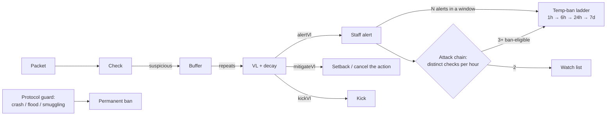

# BastionAC

<p><b>English</b> · <a href="README.ru.md">Русский</a> · <a href="../README.md">← Bastion</a></p>

A server-side anti-cheat engine for Fabric (Minecraft 1.21.11). It needs no client
mod. It started as a targeted answer to **Meteor** and its forks and grew into a
general engine; version 2.24 added a full pass over **Wurst 7**, built from that
client's own source and defaults.

## New in 3.0 — telemetry and Argus

- **Session telemetry.** Every session is recorded to its own compact binary file
  (`logs/bastionac/sessions/`): movement packets with their arrival time, the keys
  held (1.21.2+ `PlayerInput`), client tick ends, teleports and their confirms,
  server put-backs, knockback, a 1 Hz server-side state sample, ping, every block
  broken with how exposed it was, the 5×5×5 around every valuable ore, attacks with
  their aim geometry. About half a megabyte per player-hour, written on its own
  low-priority thread, held under a size cap (3 GB by default) and a retention
  (30 days). `tools/btl_dump.py` turns a file into text.
- **Argus**, an analytical investigation beside the checks. It does not react to a
  single flag: an alert, an EDR chain, an X-ray probe, a loop of server put-backs,
  an admin's request or its own scan of a finished session opens a *case*. The case
  is read on the Argus thread: a vanilla physics replay (air control, ground
  friction, gravity, jumps and pushes against the keys actually held), timing and
  protocol shape (tick rate, held-back movement, faked ping), aim and clicking,
  and for X-ray how much ore the tunnels revealed against what a blind tunnel
  through the same rock would reveal (read from a sample of the world). Every
  feature is compared with this server's own honest players (median/MAD) and the
  player's own history; the result is a calibrated score and a plain-language
  report, within the hour.
- **Modes**: shadow (cases only), assist (staff get the verdict and a button,
  default), auto (a confident verdict with independent evidence bans by itself).
  The owner's "cheater / not a cheater" labels retrain the weights.
- **False positives fixed**: PacketOrder in server put-back loops (teleport
  handshake now matched by vanilla's teleport id), Timer and Blink under network or
  server stalls (now a balance on packet *arrival* time with a lag credit), X-ray
  exposure (liquids and see-through blocks count as open; deepslate counts as
  stone).
- **New check `entitypredict`**: an attack on an entity the client was never sent
  (CrystalAura id prediction).

## Two principles

1. **Nothing is punished on one event.** Suspicious ticks fill a buffer, and the
   buffer feeds a violation level (VL) that decays over time. Only a pattern that
   keeps repeating crosses a threshold. False positives are kept out by design, not
   by hand-tuning.
2. **Check the outcome, not the signature.** A signature catches one
   implementation and breaks on the next; an outcome ("this player took no fall
   damage although vanilla had to charge it") catches all of them. Where it helps,
   both run side by side.

## Checks (40)

| Area | Checks |
|---|---|
| Movement | Speed · Fly · HighJump · BigMove · Timer (balance on arrival time) · Blink · NoSlow · NoWeb · GroundSpoof · AntiHunger · NoFall (by packet *and* by outcome) · FastFall (vanilla gravity curve) · Spider · FastLadder · Jesus · Step · PacketOrder |
| Combat | Reach (lag-compensated against the victim's hitbox history) · Angle · Aim (exact hitbox-centre lock, flick-and-return) · Walls · MultiTarget · UseAttack · NoSwing · Criticals · Velocity · CPS · AutoTotem · EntityPredict (an attack on an entity the client was never sent — CrystalAura id prediction) |
| World | FastBreak · FastPlace · Nuker · PacketMine · Scaffold · AirPlace · AutoPlace (computed face-centre clicks) · XRay (statistical, observe-only) |
| Rhythm | AutoClick · AutoAction — machine-even timing at human-plausible rates |
| Client & transport | Vehicle (BoatFly) · InvMove · BrandSpoof · GCD (aim grid) · BadRotation |
| Protocol guard | Packet flood · book/NBT bombs · creative-slot smuggling |
| Analysis (Argus) | Not checks but a session-level investigation: vanilla physics replay, tick rate and held-back movement, faked ping, aim and clicking, X-ray reveal test against the world — see «New in 3.0» |

40 is the number of check types. HighJump, NoWeb, AntiHunger and FastLadder are signatures inside Fly, NoSlow, GroundSpoof and Spider. The protocol guard is a separate filter, and Argus is a separate analysis layer.

## Client versions

The mod runs on a **Minecraft 1.21.11** server. Players on other versions
(**1.21.1 – 26.3**) are admitted by ViaVersion and ViaBackwards on the server, and
the anti-cheat knows each player's real protocol: a client older than 1.21.2 has no
tick ends and no `PlayerInput` of its own (Via makes them up), so the checks and
features that depend on them use the move-packet clock or stand down for it.

Some of these rest on facts rather than statistics:
- **PacketOrder** — since 1.21.2 the client closes every tick with
  `ClientTickEnd`, and a vanilla client sends at most one movement packet per tick.
- **Step** — the `+0.42 / +0.753` packet pair.
- **BadRotation** — a pitch beyond ±90°.
- **AutoPlace** — clicks at the exact geometric centre of a block face.

A vanilla client can produce none of these.

## From a flag to a ban



- Heuristic checks such as GCD, AutoClick and XRay are **observe-only**. They alert
  staff and never ban on their own.
- Operators are never auto-banned.
- The chain detector counts *different* checks, not points. One module cannot ban
  a player through the chain on its own.

## Tooling for staff

- **`/bac` panel.** A chest GUI with:
  - online players and their VLs;
  - alert and punishment history;
  - attack chains;
  - the network map of linked accounts;
  - in-game settings for every check.
- **Clickable alerts.** Hovering shows the check, details, coordinates and ping;
  clicking teleports you to the player.
- **Context buffer.** On the first alert, the packets that led up to it are frozen
  so they can be reviewed later.
- **Shadow telemetry.** Measures packet pressure and the cost of each check without
  ever acting on it.

## Build

```bash
./gradlew build   # JDK 21 → build/libs/bastionac-<version>.jar
./gradlew test    # 110 unit tests
```

The config is `config/bastionac/config.json`. It has per-check weight, alert,
mitigate and kick thresholds and decay. It migrates itself between schema versions
and never overwrites the admin's own tuning.

Full Russian documentation and version history: [`DETAILS.ru.md`](DETAILS.ru.md).
