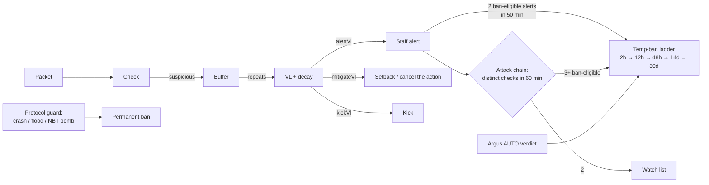

# BastionAC

<p><b>English</b> · <a href="README.ru.md">Русский</a> · <a href="../README.md">← Bastion</a></p>

A server-side anti-cheat engine for Fabric (Minecraft 1.21.11). It needs no client
mod. It started as a targeted answer to **Meteor** and its forks and grew into a
general engine; version 2.24 added a full pass over **Wurst 7**, built from that
client's own source and defaults.

## New in 3.4

- **ClickTP closed.** One packet carrying a player on foot more than 2 blocks
  sideways (scaled by the speed attribute) is a teleport: BigMove flags it and
  sets the player back. A client sends one position per tick whatever its ping,
  and honest play peaks near 0.6 blocks a tick; elytra, riptide, vehicles,
  server-granted flight and knockback have their own allowances. Before, only
  jumps past 6 blocks — 7.8 while sprinting — were caught.
- **Argus sees teleports** (`move.teleport`, a physically impossible fact) and no
  longer reads hovering in creative as flying against gravity.
- **When it happened:** every feature in a case and in its report lists the times
  of its events.
- Building into someone's claim no longer looks like HighJump: a jump off a block
  the server just refused counts from that block's top.

## New in 3.3.2 (hotfix)

- **Argus for players who left.** An investigation of an offline player reads
  their last recorded session; the name is matched case-insensitively against
  their telemetry. Before, every request read the hour before now — empty for
  a player who had left.
- **Investigate a past alert.** In the alert history: left click — Argus reads the
  session that was running at that alert; right click — teleport to where it
  happened; shift-left — the player's cases (offline too).
- **Outcomes are visible.** Each alert shows Argus's case and verdict; a case opened
  by alerts that ends clean or with too little data tells staff once; cases closed
  in the last day stay listed.
- Coordinates in the alert line and in the history; the plain entity-interact
  packet is judged by its click point (trading over a counter); sounds moved by
  the info shield keep their loudness.

## New in 3.3.1

- **Info shield.**
  - Other players' health goes out as "alive at full health" and their
    absorption as none; what they wear and hold goes out with its looks only,
    without enchantments, durability, names or contents.
  - Global sounds (dragon, Wither, End portal) and far horns arrive from a
    point towards the source instead of its coordinates.
- **InteractWalls:** clicking a block, breaking one or right-clicking an entity
  through a wall is refused (hits through walls were already Walls). It is
  light: one ray, only on the action itself.
- **The Nether only up to its fog:** players there are sent chunks out to the
  fog at 96 blocks (6 chunks), not the full view distance. That is fewer
  chunks, so less load.
- **A dead player's actions are dropped** (death-screen dupes and ghost hits).

## New in 3.3

- **Argus is trained.** Argus Lab generates synthetic sessions in the real
  telemetry format:
  - honest players of every ping, sensitivity, aim and click rhythm;
  - honest players on a bad day;
  - 12 cheats at adjustable strength, alone and in bundles.
  Every session runs through the live feature code and scorer.
- **The trained model ships with the mod** (`bastionac/argus-prior.json`).
  Staff labels refine it instead of starting from all-ones. It is trained on
  three independent corpora (bagging), with and without server norms. On the
  held-out set, at 0 % false alarms (0 % on the stress set too), detection
  is 75.7 % with norms and 70.4 % on a fresh server: X-ray 100 %, smooth
  KillAura 100 % (86 % without norms), Blink 92 %, PingSpoof 67 %, Reach
  +0.9 100 %, AimAssist at full strength 50 %.
- **Lag-compensated aim and reaction lag.** Aim error is measured against the
  target's track at the moment the player could see it: on a 100 ms ping a
  KillAura used to "miss like a human". The aim's reaction time to the
  target's own jinks (minus ping and interpolation) is 3.5–6.4 ticks for a
  hand and ≈ 0 for an aura; the strength of the answer with no reaction at
  all is 0.02–0.10 for a hand and 0.6–0.8 for an aura.
- **Training safeguards:**
  - one feature adds at most 1.2 logit to any honest session;
  - an empty session is never suspicious (bias ≤ −2.5);
  - a labelled cheater with no evidence teaches nothing.
- **Fixed:**
  - per-hour features (Blink) now count episodes, not hours;
  - the click rhythm ignores pauses (log scale);
  - reach is judged at any ping, with the allowance taken from how fast the
    target actually backed off.
- `./gradlew argusLab` runs the bench; `--args="500 12 --write"` retrains the
  model. Full report in Russian: [ARGUS-LAB.ru.md](ARGUS-LAB.ru.md).

## New in 3.2 — Argus progress, live

The case card shows what Argus is doing with the case right now and how long it
takes, redrawn twice a second while the card is open: collecting (with a
countdown), queued (jobs ahead), waiting for a lagging server, then each stage of
the analysis — telemetry files read, physics replay, packets, combat, client, the
rock around the tunnels (cells read), mining, scoring — and finally the wait for
the final pass. Every stage's time is kept for the last run. The case list updates
the cases that are moving. Only the changed slot is sent; the window is never
reopened.

## New in 3.1

- **Argus obeys staff and answers in minutes.** A cheater / not a cheater / ban /
  close decision is final; a case is never analysed twice at once; the first
  verdict comes in a couple of minutes, the final one at once on guilty or when
  the player leaves.
- **Argus is sharper.** A bug that let computed aim (rotations off the mouse
  sensitivity grid) go uncounted is fixed; reach ignores high-ping hits. End-to-end
  scenarios in the tests: honest — clean, KillAura — guilty, reach — suspect,
  Speed+Timer — guilty. The server norms cannot be poisoned by one player.
- **X-ray is visible to staff** — an `[X-ray]` alert in chat and `[XRAY]` in the console.
- **BrandSpoof** catches a changed or doctored brand, a missing one and a 1.21.2+
  client without `ClientTickEnd`.
- **Backtrack via PingSpoof closed:** the lag-compensation window is capped by
  the server's own transactions.
- Offline operators are exempt from delayed bans.
- **3.1.2:** one case per episode — a signal hours after a case went quiet opens
  a new case instead of re-reading days of old play; AUTO bans need at least
  10 minutes of telemetry unless a fact is physically impossible; the reach
  window spans the recent round-trip range on a jittery connection (capped).

## New in 3.0 — telemetry and Argus

- **Session telemetry.** Every session is recorded to its own compact binary file
  (`logs/bastionac/sessions/`): movement packets with their arrival time, the keys
  held (1.21.2+ `PlayerInput`), client tick ends, teleports and their confirms,
  server put-backs, knockback, a 1 Hz server-side state sample, ping, every block
  broken with how exposed it was, the 5×5×5 around every valuable ore, attacks with
  their aim geometry. About half a megabyte per player-hour, written on its own
  low-priority thread, held under a size cap (3 GB by default) and a retention
  (30 days). `tools/btl_dump.py` turns a file into text.
- **Argus**, an analytical investigation beside the checks. It does not react to a
  single flag: an alert, an EDR chain, an X-ray probe, a loop of server put-backs,
  an admin's request or its own scan of a finished session opens a *case*. The case
  is read on the Argus thread: a vanilla physics replay (air control, ground
  friction, gravity, jumps and pushes against the keys actually held), timing and
  protocol shape (tick rate, held-back movement, faked ping), aim and clicking,
  and for X-ray how much ore the tunnels revealed against what a blind tunnel
  through the same rock would reveal (read from a sample of the world). Every
  feature is compared with this server's own honest players (median/MAD) and the
  player's own history; the result is a calibrated score and a plain-language
  report: a first verdict within minutes, the final one at once when it is guilty
  or the player has left, otherwise after 15 minutes. A staff decision (cheater /
  not a cheater / ban / close) closes the case for good.
- **Modes**: shadow (cases only), assist (staff get the verdict and a button,
  default), auto (a confident verdict with independent evidence bans by itself).
  The owner's "cheater / not a cheater" labels retrain the weights.
- **False positives fixed**: PacketOrder in server put-back loops (teleport
  handshake now matched by vanilla's teleport id), Timer and Blink under network or
  server stalls (now a balance on packet *arrival* time with a lag credit), X-ray
  exposure (liquids and see-through blocks count as open; deepslate counts as
  stone).
- **New check `entitypredict`**: an attack on an entity the client was never sent
  (CrystalAura id prediction).

## Three principles

1. **Nothing is punished on one event.** Suspicious ticks fill a buffer, and the
   buffer feeds a violation level (VL) that decays over time. Only a pattern that
   keeps repeating crosses a threshold. False positives are kept out by design, not
   by hand-tuning.
2. **Check the outcome, not the signature.** A signature catches one
   implementation and breaks on the next; an outcome ("this player took no fall
   damage although vanilla had to charge it") catches all of them. Where it helps,
   both run side by side.
3. **Stay light; move the heavy thinking off the tick.** The live checks are cheap:
   one comparison per packet, one ray per action, buffers instead of a full
   movement simulation on every packet. The expensive work — a physics replay of
   the whole session, combat statistics, the X-ray test against the world — runs
   once per case, on Argus's own thread, and pauses while the server is busy
   (MSPT above 45). Prediction is not dropped; it is moved off the hot path. The
   price is a small window for subtle combat tweaks that Argus then catches from
   the session statistics, not on the first hit.

## Information and exploit protection

An anti-cheat that only reads packets reacts after the fact. BastionAC also
works ahead of the cheat: it does not send what a cheat could exploit, and it
drops what a vanilla client could never send.

**Information cheats are starved, not chased.** A cheat that only *reads*
packets sends nothing suspicious back, so it cannot be detected — only left with
nothing to read (`InfoShield`, outgoing packets):

| Leak | What the client gets instead |
|---|---|
| other players' health (health ESP) | "alive at full health"; 0 still plays the death animation; no absorption |
| other players' gear (enchantments, durability, names, shulker contents) | the item's looks only: model, trim, dye, banner, head, glint |
| global and far sounds — dragon, Wither, End portal, horns (coordinates in the packet) | a point towards the source along the same line: the direction stays, the coordinates go |
| everything past the Nether fog (terrain, players, mobs for a fog-less client or ESP) | chunks only up to the fog at 96 blocks (`netherViewDistance` 6) |
| with BastionAuth: the account before the password (location, inventory, effects, game mode, chat) | limbo above spawn, an empty inventory, a plain survival picture, chat held until login |

**Exploits are blocked at the protocol, on the spot.** Things a vanilla client
can never produce need no statistics:

| Exploit | Response |
|---|---|
| book and NBT bombs (past the vanilla 100 pages × 1024 characters) | dropped, permanent ban |
| creative-slot item smuggling outside creative (grace window after a game-mode change) | dropped, permanent ban |
| packet floods (sustained rate over a window) | permanent ban |
| BookBot (book edits faster than the screen allows) | kick |
| actions from the death screen (dupes at death, hits from the grave) | dropped |
| clicking, breaking or using an entity through a wall (`InteractWalls`) | refused and resynced |
| an attack on an entity the client was never sent (`EntityPredict`) | flagged, attack dropped |
| with BastionAuth: any packet before login except the handful needed to log in | dropped before its handler |

Not covered yet: players behind walls are still sent to the client, so a plain
player ESP works, and ore blocks are sent as they are — X-ray is caught by
statistics and an alert to staff, not hidden.

## Checks (41)

| Area | Checks |
|---|---|
| Movement | Speed · Fly · HighJump · BigMove · Timer (balance on arrival time) · Blink · NoSlow · NoWeb · GroundSpoof · AntiHunger · NoFall (by packet *and* by outcome) · FastFall (vanilla gravity curve) · Spider · FastLadder · Jesus · Step · PacketOrder |
| Combat | Reach (lag-compensated against the victim's hitbox history) · Angle · Aim (exact hitbox-centre lock, flick-and-return) · Walls · MultiTarget · UseAttack · NoSwing · Criticals · Velocity · CPS · AutoTotem · EntityPredict (an attack on an entity the client was never sent — CrystalAura id prediction) |
| World | FastBreak · FastPlace · Nuker · PacketMine · Scaffold · AirPlace · AutoPlace (computed face-centre clicks) · InteractWalls (a block clicked or broken, or an entity used, through a wall) · XRay (statistical, staff alerts, never bans) |
| Rhythm | AutoClick · AutoAction — machine-even timing at human-plausible rates |
| Client & transport | Vehicle (BoatFly) · InvMove · BrandSpoof · GCD (aim grid) · BadRotation |
| Protocol guard | Packet flood · book/NBT bombs · creative-slot smuggling |
| Analysis (Argus) | Not checks but a session-level investigation: vanilla physics replay, tick rate and held-back movement, faked ping, aim and clicking, X-ray reveal test against the world — see «New in 3.0» |

41 is the number of check types. HighJump, NoWeb, AntiHunger and FastLadder are signatures inside Fly, NoSlow, GroundSpoof and Spider. The protocol guard is a separate filter, and Argus is a separate analysis layer.

## Client versions

The mod runs on a **Minecraft 1.21.11** server. Players on other versions
(**1.21.1 – 26.3**) are admitted by ViaVersion and ViaBackwards on the server, and
the anti-cheat knows each player's real protocol: a client older than 1.21.2 has no
tick ends and no `PlayerInput` of its own (Via makes them up), so the checks and
features that depend on them use the move-packet clock or stand down for it.

Some of these rest on facts rather than statistics:
- **PacketOrder** — since 1.21.2 the client closes every tick with
  `ClientTickEnd`, and a vanilla client sends at most one movement packet per tick.
- **Step** — the `+0.42 / +0.753` packet pair.
- **BadRotation** — a pitch beyond ±90°.
- **AutoPlace** — clicks at the exact geometric centre of a block face.

A vanilla client can produce none of these.

## From a flag to a ban



- **VL.** Every flag adds the check's `weight` to its VL; the VL decays by
  `decayPerSecond`. Crossing `alertVl` alerts staff, `mitigateVl` sets the
  player back or drops the action, `kickVl` kicks. `-1` turns a stage off.
- **Temp-ban.** `alertsToBan` (2) alerts from ban-eligible checks inside
  `alertWindowMinutes` (50) ban through the vanilla ban list. The length is
  picked by how many bans the player already had in `banHistoryHours`
  (336 h = 14 days): `banStepsHours` = 2 → 12 → 48 → 336 → 720 hours.
- **Never ban on their own** (`banExcludedChecks`, 21 checks): bigmove, timer,
  groundspoof, noswing, autoclick, autoaction, velocity, gcd, xray, vehicle,
  airplace, invmove, brandspoof, packetorder, aim, autoplace, jesus, autototem,
  fastfall, entitypredict, interactwalls. They alert, mitigate and feed the
  chain; staff decide.
- **Observe-only** (no setback, no kick): autoclick, autoaction, noswing,
  groundspoof, multitarget, gcd, xray, brandspoof, autototem. BadRotation does
  not mitigate but kicks at VL 15.
- **Chain** (`AttackChainDetector`): within `chainWindowMinutes` (60), 2 distinct
  checks at alert level put the player on the watch list; 3 distinct
  ban-eligible checks ban through the same ladder. It counts *different* checks,
  not points, so one module cannot ban a player through the chain. Recon and
  evasion (leaving before a kick, rejoining) are context and never ban.
- **Catastrophic filters** (crash exploits, packet floods, NBT and book bombs)
  ban permanently at once (`catastrophicPermabanEnabled`; when off, the longest
  ladder step instead).
- **Staff** (operator level 3+) are never auto-banned, by the ladder, a chain,
  Argus or the catastrophic filters. They are still alerted and kicked.

## Commands

All `/bac` commands need operator level 3 or higher.

| Command | |
|---|---|
| `/bac`, `/bac panel` | Open the panel |
| `/bac alerts` | Turn alerts on or off for yourself |
| `/bac status <name>` | A player's current VLs |
| `/bac freeze <name> [reason]` · `unfreeze <name>` · `frozen` | Freeze a player for a check, release them, list frozen players |
| `/bac argus` · `argus case <id>` · `argus explain <id>` | Argus case list, one case card, its report in chat |
| `/bac argus analyze <name>` · `argus status` | Open a case on a player (offline too), Argus queue state |
| `/bac argus mode shadow\|assist\|auto` | Argus mode |
| `/bac telemetry [name]` | Telemetry state, for the server or one player |
| `/bac reload` · `/bac version` | Reload the config · version |

## Tooling for staff

- **`/bac` panel.** A chest GUI with:
  - online players and their VLs;
  - alert and punishment history;
  - attack chains;
  - the network map of linked accounts;
  - in-game settings for every check.
- **Clickable alerts.** Hovering shows the check, details, coordinates and ping;
  clicking teleports you to the player.
- **Context buffer.** On the first alert, the packets that led up to it are frozen
  so they can be reviewed later.
- **Shadow telemetry.** Measures packet pressure and the cost of each check without
  ever acting on it.

## Technical reference

### Default thresholds

Fresh-install values of `checks.<name>` in `config.json`. "—" in mitigate/kick
means `-1` (stage off); "Bans" says whether the check's alerts count towards
the temp-ban and the chain.

| Check | Weight | Alert VL | Mitigate VL | Kick VL | Decay /s | Bans |
|---|---|---|---|---|---|---|
| `speed` | 1.0 | 6 | 8 | 20 | 0.75 | ✓ |
| `fly` | 1.0 | 5 | 7 | 20 | 0.75 | ✓ |
| `spider` | 3.0 | 3 | 4 | 8 | 0.5 | ✓ |
| `timer` | 1.0 | 4 | 6 | 16 | 0.1 | — |
| `bigmove` | 5.0 | 5 | 5 | 20 | 0.5 | — |
| `groundspoof` | 1.0 | 5 | — | — | 0.5 | — |
| `nofall` | 2.0 | 3 | 5 | 12 | 0.4 | ✓ |
| `reach` | 1.0 | 3 | 5 | 7 | 0.5 | ✓ |
| `angle` | 1.0 | 4 | 7 | 10 | 0.75 | ✓ |
| `walls` | 1.0 | 3 | 6 | 8 | 0.5 | ✓ |
| `multitarget` | 1.0 | 4 | — | — | 0.75 | ✓ |
| `useattack` | 1.0 | 2 | 3 | 10 | 0.5 | ✓ |
| `noswing` | 1.0 | 4 | — | — | 0.75 | — |
| `cps` | 1.0 | 4 | 6 | 15 | 1.0 | ✓ |
| `fastbreak` | 1.0 | 3 | 5 | 12 | 0.5 | ✓ |
| `nuker` | 1.0 | 3 | 5 | 12 | 0.5 | ✓ |
| `fastplace` | 1.0 | 4 | 6 | 15 | 1.0 | ✓ |
| `autoclick` | 1.0 | 3 | — | — | 0.05 | — |
| `autoaction` | 1.0 | 3 | — | — | 0.05 | — |
| `velocity` | 2.0 | 3 | 5 | 12 | 0.5 | — |
| `packetmine` | 2.0 | 4 | 6 | 12 | 0.5 | ✓ |
| `criticals` | 1.0 | 3 | 5 | 12 | 0.5 | ✓ |
| `blink` | 2.0 | 3 | 5 | 12 | 0.5 | ✓ |
| `noslow` | 1.0 | 3 | 5 | 12 | 0.5 | ✓ |
| `scaffold` | 2.0 | 4 | 6 | 12 | 0.5 | ✓ |
| `gcd` | 2.0 | 3 | — | — | 0.05 | — |
| `xray` | 2.0 | 3 | — | — | 0.05 | — |
| `vehicle` | 2.0 | 4 | 6 | 14 | 0.5 | — |
| `airplace` | 3.0 | 3 | 4 | 10 | 0.5 | — |
| `interactwalls` | 2.0 | 3 | 4 | 12 | 0.5 | — |
| `invmove` | 1.5 | 4 | 6 | 14 | 0.5 | — |
| `brandspoof` | 6.0 | 5 | — | — | 0.02 | — |
| `packetorder` | 2.0 | 4 | 6 | 14 | 0.4 | — |
| `aim` | 2.0 | 4 | 6 | 12 | 0.1 | — |
| `autoplace` | 2.0 | 4 | 6 | 12 | 0.2 | — |
| `jesus` | 1.5 | 4 | 5 | 12 | 0.5 | — |
| `step` | 3.0 | 3 | 6 | 12 | 0.3 | ✓ |
| `autototem` | 3.0 | 3 | — | — | 0.02 | — |
| `badrotation` | 5.0 | 5 | — | 15 | 0.2 | ✓ |
| `fastfall` | 2.0 | 4 | 6 | 12 | 0.5 | — |
| `entitypredict` | 3.0 | 3 | 3 | 12 | 0.2 | — |

Selected `general` keys: `maxCps` 14 (hits above it are dropped), `joinGraceTicks`
60, `setbackMinIntervalTicks` 10, `timerMaxAheadMs` 400, `timerLagBankMs` 3000,
`velocityVerifyTicks` 4, `velocityMinRatio` 0.6, `velocityConfirmStreak` 3,
`blinkMaxIatStdMs` 1.0, `noSlowMaxFactor` 0.35. Info shield:
`hideOtherPlayersHealth`, `hideOtherPlayersEquipmentDetails`,
`hideSoundOrigins`, `ignoreDeadPlayerActions` (all on), `netherViewDistance` 6
(0 = off).

### Argus

| Key | Default | Meaning |
|---|---|---|
| `argus.mode` | `ASSIST` | `SHADOW` cases only · `ASSIST` verdict + button for staff · `AUTO` bans on its own |
| `collectMinutes` | 2 | collecting after the first signal before the first analysis |
| `reanalyzeMinutes` | 3 | a case with new signals is read again at most this often |
| `deadlineMinutes` | 15 | the final verdict at the latest (sooner on guilty or when the player leaves) |
| `windowMinutes` | 60 | telemetry read before the signal |
| `suspectScore` / `guiltyScore` | 0.60 / 0.95 | verdict thresholds |
| `autoBanScore` | 0.97 | AUTO bans only from this score, with independent evidence |
| `autoBanMinMinutes` | 10 | AUTO needs this much telemetry unless a fact is physically impossible |
| `minBaselineSessions` | 20 | AUTO needs this many honest sessions in the server norms first |
| `pauseAboveMspt` | 45 | the analyser pauses while the server tick is slower |
| `caseRetentionDays` | 60 | closed cases are kept this long |
| `worldSampleBlocksPerTick` | 6000 | how fast the X-ray test may read the world |

Features (40, `Features.ALL`) by group:
- **Movement** — `move.air_gain`, `air_turn`, `ground_gain`, `rise`, `fall_fast`,
  `jump_nokey`, `move_nokey`, `input_dir`, `sprint_noforward`, `teleport`.
- **Packets** — `pkt.tick_rate`, `extra_moves`, `timer_episodes`, `blind_stall`,
  `phase_loops`, `ping_gap`.
- **Combat** — `cmb.reach`, `reach_lc`, `reach_over`, `aim_error`, `aim_lc_error`,
  `aim_center`, `aim_lc_center`, `track_lag`, `track_instant`, `snap`, `rot_const`,
  `gcd_off`, `yaw_grid`, `yaw_wrap`, `click_rhythm`, `rhythm_kurt`, `blind_hit`.
- **Client** — `cli.brand_spoof`, `cheat_channel`.
- **Mining** — `mine.reveal_z`, `diamond_reveal_z`, `discovery_rate`,
  `diamond_discovery`, `wall_breaks`.

Six are *hard* — a vanilla client cannot produce them at all, so they may stand
on their own: `move.jump_nokey`, `move.teleport`, `pkt.tick_rate`, `cmb.yaw_wrap`,
`mine.wall_breaks`, `cli.cheat_channel`.

Each feature is scored against the server's own median/MAD of honest players and
the player's history, then combined by a logistic model whose prior ships in
`bastionac/argus-prior.json` and is refined by staff labels.

### Telemetry

`telemetry.enabled` (on), `retentionDays` 30, `maxTotalMb` 3072, `maxSessionMb`
200 (a runaway session stops recording movement), `pingIntervalTicks` 40,
`recordTargets` and `recordOreContext` on. Files are
`logs/bastionac/sessions/<date>/<uuid>__<name>__<start>.btl.gz`, written on a
low-priority thread; `tools/btl_dump.py` prints one as text.

### Files

| Path | What |
|---|---|
| `config/bastionac/config.json` | settings; schema version 15, migrated on start without overwriting the admin's own values |
| `config/bastionac/bans.json` · `history.json` · `networks.json` · `frozen.json` | bans and ban history, alert/punishment history, linked-account map, frozen players |
| `config/bastionac/argus/cases.json` · `baselines.json` · `model.json` | Argus cases, server norms, the trained weights |
| `logs/bastionac/sessions/` | session telemetry |
| `logs/bastionac/argus/` | Argus reports |
| `logs/bastionac/dumps/` | context-buffer packet dumps (`.dump.gz`) from first alerts |

### With BastionAuth

Through reflection, with no hard dependency: the checks stand down while
BastionAuth holds a player before login; the limbo return is announced in
advance (`expectServerMove`), so it is not read as a teleport; the client brand
BastionAuth captured in the configuration phase feeds BrandSpoof; linked
accounts arrive through `noteLinkedAccount`, and the panel's network tab reads
and sets verdicts in BastionAuth's link ledger.

## Build

```bash
./gradlew build      # JDK 21 → build/libs/bastionac-<version>.jar
./gradlew test       # 202 unit tests
./gradlew argusLab   # Argus Lab bench; --args="500 12 --write" retrains the prior
```

Gradle's forked test worker cannot run from a path with non-ASCII characters;
on such a path `./gradlew test` skips the tests, so build from an ASCII path.

Full Russian documentation and version history: [`DETAILS.ru.md`](DETAILS.ru.md).
Argus Lab report (Russian): [`ARGUS-LAB.ru.md`](ARGUS-LAB.ru.md).
