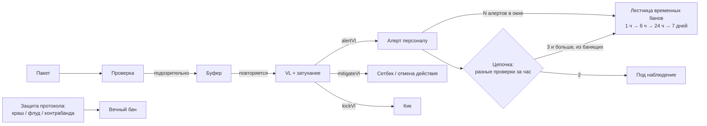

# BastionAC

<p><a href="README.md">English</a> · <b>Русский</b> · <a href="../README.ru.md">← Bastion</a></p>

Серверный античит для Fabric (Minecraft 1.21.11). Мод на клиенте не нужен.
Начинался как ответ на **Meteor** и его производные, потом вырос в общий движок.
В версии 2.24 полностью разобран **Wurst 7** — по исходникам и настройкам этого
клиента.

## Новое в 3.1

- **Аргус слушается персонал и отвечает за минуты.** Решение «читер / не читер /
  бан / закрыть» окончательно; у дела не бывает двух разборов сразу; первый
  вердикт — через пару минут, итог — сразу при «виновен» или уходе игрока.
- **Аргус точнее.** Исправлен баг, из-за которого вычисленный аим (повороты вне
  сетки чувствительности мыши) не засчитывался; Reach считается без ударов на
  высоком пинге. Сквозные сценарии в тестах: честный игрок — чисто, KillAura —
  виновен, Reach — подозрительно, Speed+Timer — виновен. Нормы сервера защищены
  от «отравления» одним игроком.
- **X-ray виден персоналу** — алерт `[X-ray]` в чате и `[XRAY]` в консоли.
- **BrandSpoof** ловит смену и подделку бренда, его отсутствие и клиент 1.21.2+
  без `ClientTickEnd`.
- **Backtrack через PingSpoof закрыт:** окно лаг-компенсации ограничено
  собственными транзакциями.
- Офлайн-операторы не попадают под отложенные баны.

## Новое в 3.0 — телеметрия и Аргус

- **Телеметрия сессий.** Каждая сессия пишется в свой компактный двоичный файл
  (`logs/bastionac/sessions/`):
  - пакеты движения со временем прихода;
  - нажатые клавиши (`PlayerInput` с 1.21.2) и концы тиков клиента;
  - телепорты и их подтверждения, откаты сервера, отброс;
  - раз в секунду — состояние игрока глазами сервера и пинг;
  - каждый сломанный блок с тем, насколько он был открыт, и 5×5×5 вокруг каждой ценной руды;
  - удары с геометрией прицела.

  Это около половины мегабайта на игрока в час. Запись идёт в отдельном потоке, папка
  держится в лимите (3 ГБ) и сроке хранения (30 дней). `tools/btl_dump.py` превращает
  файл в текст.
- **Аргус** — аналитическое расследование поверх проверок. Он не реагирует на
  одиночный флаг. Дело открывают:
  - алерт проверки или цепочка EDR;
  - проба X-ray;
  - цикл откатов сервера;
  - запрос администратора;
  - фоновый разбор законченной сессии.

  Дело разбирается в отдельном потоке:
  - повтор ванильной физики: управление в воздухе, трение, гравитация, прыжки и
    разгон против реально нажатых клавиш;
  - форма тайминга и протокола: частота тиков, придержанное движение, подмена пинга;
  - прицел и клики;
  - для X-ray — сколько руды вскрыли туннели против того, что вскрыл бы слепой туннель
    в той же породе (по образцу мира вокруг шахты).

  Каждый признак сравнивается с честными игроками этого сервера (медиана и MAD) и с
  собственной историей игрока. Итог — откалиброванная оценка и отчёт простым языком:
  первый вердикт через несколько минут, итог — сразу при «виновен» или уходе игрока,
  иначе через 15 минут. Решение персонала (читер / не читер / бан / закрыть) закрывает
  дело окончательно.
- **Режимы:**
  - тень — только дела;
  - помощник — персонал получает вердикт и кнопку (по умолчанию);
  - авто — уверенный вердикт с независимыми уликами банит сам.

  Пометки владельца «читер / не читер» переобучают веса.
- **Исправлены ложные срабатывания:**
  - PacketOrder в циклах откатов сервера — подтверждение телепорта сверяется по ванильному номеру;
  - Timer и Blink при зависании сети или сервера — теперь баланс по времени *прихода*
    пакета с запасом на лаг;
  - открытость руды для X-ray — жидкости и прозрачные блоки считаются открытыми,
    глубинный сланец считается камнем.
- **Новая проверка `entitypredict`** — удар по сущности, которую клиенту ещё не
  показывали (предсказание id в CrystalAura).

## Два принципа

1. **Ни одно событие не наказывается сразу.** Подозрительные тики копятся в
   буфере, буфер растит уровень нарушений (VL), а VL со временем затухает. Порог
   переходит только то, что стабильно повторяется. Ложные срабатывания отсечены
   устройством движка, а не подкруткой порогов.
2. **Проверять исход, а не сигнатуру.** Сигнатура ловит одну реализацию чита и
   ломается на следующей. Исход («игрок не получил урона от падения, хотя обязан
   был») ловит любую. Там, где это помогает, работают оба пути сразу.

## Проверки (40)

| Область | Проверки |
|---|---|
| Движение | Speed · Fly · HighJump · BigMove · Timer (баланс по времени прихода) · Blink · NoSlow · NoWeb · GroundSpoof · AntiHunger · NoFall (по пакетам *и* по исходу) · FastFall (ванильная кривая гравитации) · Spider · FastLadder · Jesus · Step · PacketOrder |
| Бой | Reach (с лаг-компенсацией по истории хитбокса жертвы) · Angle · Aim (прицел точно в центр хитбокса, рывок и возврат взгляда) · Walls · MultiTarget · UseAttack · NoSwing · Criticals · Velocity · CPS · AutoTotem · EntityPredict (удар по сущности, которую клиенту ещё не показывали, — предсказание id в CrystalAura) |
| Мир | FastBreak · FastPlace · Nuker · PacketMine · Scaffold · AirPlace · AutoPlace (вычисленные клики в центр грани) · XRay (статистика, алерты персоналу, без банов) |
| Ритм | AutoClick · AutoAction — машинная ровность при «человеческой» частоте |
| Клиент и транспорт | Vehicle (BoatFly) · InvMove · BrandSpoof · GCD (сетка чувствительности мыши) · BadRotation |
| Защита протокола | флуд пакетами · книги-бомбы и NBT-бомбы · контрабанда предметов креативными пакетами |
| Анализ (Аргус) | Не проверки, а расследование на уровне сессии: повтор ванильной физики, частота тиков и придержанное движение, подмена пинга, прицел и клики, тест X-ray по образцу мира — см. «Новое в 3.0» |

40 — это число типов проверок. HighJump, NoWeb, AntiHunger и FastLadder — сигнатуры внутри Fly, NoSlow, GroundSpoof и Spider. Защита протокола — отдельный фильтр, Аргус — отдельный слой анализа.

## Версии клиентов

Мод работает на сервере **Minecraft 1.21.11**. Игроков других версий
(**1.21.1 – 26.3**) пускают ViaVersion и ViaBackwards на сервере. Античит знает
настоящий протокол каждого игрока: у клиента старше 1.21.2 нет своих концов тиков
и своего `PlayerInput` (их выдумывает Via). Поэтому проверки и признаки, которые на
них опираются, для такого клиента переходят на часы по пакетам движения или
отключаются.

Часть проверок опирается на факты, а не на статистику:
- **PacketOrder** — с 1.21.2 клиент закрывает каждый тик пакетом
  `ClientTickEnd`, а обычный клиент шлёт не больше одного пакета движения за тик.
- **Step** — пара пакетов `+0.42 / +0.753`.
- **BadRotation** — наклон головы больше ±90°.
- **AutoPlace** — клик ровно в геометрический центр грани блока.

Обычный клиент ничего из этого сделать не может.

## Путь от флага до бана



- Эвристические проверки вроде GCD, AutoClick и XRay **только наблюдают**: они
  шлют алерт персоналу и сами никогда не банят.
- Операторов автобан не трогает.
- Цепочка считает *разные* проверки, а не очки. Один модуль чита не может
  довести игрока до бана через цепочку.

## Инструменты персонала

- **Панель `/bac`.** Меню-сундук, в нём:
  - игроки онлайн и их VL;
  - история алертов и наказаний;
  - цепочки нарушений;
  - сетевая карта связанных аккаунтов;
  - настройки каждой проверки прямо в игре.
- **Кликабельные алерты.** Наведение показывает проверку, детали, координаты и
  пинг; клик телепортирует к игроку.
- **Буфер контекста.** При первом алерте сохраняются пакеты, которые к нему
  привели, — их можно разобрать потом.
- **Теневая телеметрия.** Меряет нагрузку пакетами и стоимость проверок, но
  никогда ничего не делает сама.

## Сборка

```bash
./gradlew build   # JDK 21 → build/libs/bastionac-<версия>.jar
./gradlew test    # 165 юнит-тестов
```

Конфиг — `config/bastionac/config.json`. В нём у каждой проверки свой вес, пороги
алерта, противодействия и кика и скорость затухания. Конфиг сам переходит между
версиями схемы и никогда не затирает собственную настройку админа.

Полная документация и история версий: [`DETAILS.ru.md`](DETAILS.ru.md).
