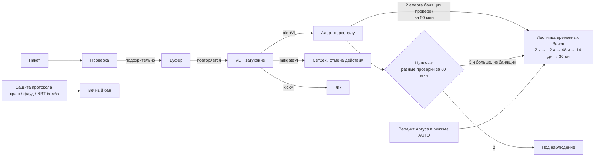

# BastionAC

<p><a href="README.md">English</a> · <b>Русский</b> · <a href="../README.ru.md">← Bastion</a></p>

Серверный античит для Fabric (Minecraft 1.21.11). Мод на клиенте не нужен.
Начинался как ответ на **Meteor** и его производные, потом вырос в общий движок.
В версии 2.24 полностью разобран **Wurst 7** — по исходникам и настройкам этого
клиента.

## Новое в 3.5 beta

- **Сборки вместо версий.** Версия мода (3.5.0-beta) меняется только с новыми
  возможностями; каждая сборка между ними получает номер:
  `bastionac-3.5.0-beta+build.4.jar`, в игре — `3.5.0-beta+build.4`.
- **Проактивный режим** (`/bac proactive on`, по умолчанию выключен). Проверки
  только копят VL и сигналят, откаты, отмены и кики придержаны. Аргус смотрит
  дело через 10 секунд после алерта и перечитывает его каждые 30 секунд. С
  оценки 75 % у игрока на 30 минут включаются все санкции, уверенный вердикт
  «виновен» банит. То, что не может ждать (полёт, скорость, таймер, транспорт,
  Blink, невозможные пакеты), режется сразу, как и без режима. Без работающего
  Аргуса режим выключается сам.
- **Худшая стычка.** Аргус оценивает каждую стычку отдельно и смотрит на худшую
  за сессию, поэтому чит, включённый на одну драку («тогглер»), не тонет в
  честной игре вокруг. Модель переобучена в Argus Lab, теперь и на реальных
  честных сессиях.
- **Ложные срабатывания.** GCD больше не путает быстрый взмах камерой с
  интерполяцией прицела; Reach по мобам учитывает, куда моб успел улететь от
  удара, и не судит удары при пинге в секунды; MultiTarget требует ударов мимо
  прицела по целям вокруг игрока, а не просто трёх целей подряд в толпе.
- **Закрытые обходы:** Anti-KB с выброшенным ответом на ping, NoSlow «пилой»,
  два пакета транспорта за тик, откат транспорта в точку чита, парящий BoatFly,
  InvMove шагом, AutoTotem через клавишу F. Флуд пакетами теперь кикает, а не
  банит навсегда, и не считается сразу после лага сервера.

## Новое в 3.4

- **ClickTP закрыт.** Один пакет, который пронёс игрока пешком больше чем на
  2 блока по горизонтали (с поправкой на атрибут скорости), — телепорт. BigMove
  его флагует и откатывает. Клиент шлёт одну позицию за тик при любом пинге,
  честная игра даёт около 0,6 блока за тик. У элитр, трезубца, транспорта,
  выданного сервером полёта и отброса свои допуски. Раньше ловились только
  скачки больше 6 блоков, а при беге — больше 7,8.
- **Аргус видит телепорты** (`move.teleport`, физически невозможный факт) и больше
  не считает зависание в творческом полётом против гравитации.
- **Когда это было:** у каждого признака в деле и в отчёте указано время событий.
- Строительство в чужом привате больше не выглядит как HighJump: прыжок с блока,
  который сервер только что отклонил, считается от верха этого блока.

## Новое в 3.3.2 (хотфикс)

- **Аргус для вышедших игроков.** Расследование офлайн-игрока читает его
  последнюю записанную сессию. Ник ищется без учёта регистра по телеметрии.
  Раньше любой запрос читал «час до сейчас», а у вышедшего игрока он пуст.
- **Расследование по старому алерту.** В истории алертов:
  - ЛКМ — Аргус читает ту сессию, что шла во время алерта;
  - ПКМ — телепорт к месту;
  - Shift+ЛКМ — дела игрока (и офлайн тоже).
- **Видно, что решил Аргус.**
  - У алерта — номер дела и вердикт.
  - Дело из алертов, закрытое как «чисто» или «мало данных», один раз пишет
    об этом персоналу.
  - Закрытые за сутки дела видны в списке.
- Координаты в строке алерта и в истории. Взаимодействие с сущностью
  проверяется по точке клика, так что торговля через прилавок проходит. Звуки,
  перенесённые щитом, не стали громче.

## Новое в 3.3.1

- **Щит информации.**
  - Здоровье других игроков уходит как «жив, полное», поглощение не
    отправляется; их броня и предметы — только внешний вид, без
    зачарований, прочности, имён и содержимого.
  - Глобальные звуки (дракон, Визер, портал в Энд) и дальние рога приходят
    из точки по направлению к источнику, а не с его координатами.
- **InteractWalls:** клик по блоку, ломание блока и правый клик по сущности
  сквозь стену отклоняются (удары сквозь стену и раньше ловил Walls).
  Проверка лёгкая: один луч и только на само действие.
- **Незер только до тумана:** игроку там отправляются чанки до тумана на 96
  блоках (6 чанков), а не на весь радиус прорисовки. Чанков меньше, значит
  нагрузка ниже.
- **Действия мёртвого игрока отбрасываются** (дюпы в момент смерти, удары
  «с того света»).

## Новое в 3.3

- **Аргус обучен.** Argus Lab генерирует синтетические сессии в настоящем
  формате телеметрии:
  - честные игроки любого пинга, чувствительности, меткости и ритма кликов;
  - честные «в плохой день»;
  - 12 читов с регулируемой силой, по одному и в связках.
  Каждая сессия проходит через живой код признаков и Scorer.
- **Обученная модель в комплекте** (`bastionac/argus-prior.json`). Метки
  персонала дообучают её, а не стартуют с «всё по 1». Обучена на трёх
  независимых корпусах (бэггинг), с нормами сервера и без них. На отложенном
  тесте при 0 % ложных тревог (и 0 % в стресс-популяции) детект 75,7 % с
  нормами и 70,4 % на свежем сервере: X-ray 100 %, плавная KillAura 100 %
  (86 % без норм), Blink 92 %, PingSpoof 67 %, Reach +0,9 — 100 %,
  AimAssist на полной силе — 50 %.
- **Прицел с учётом лага и задержка реакции.** Промах меряется против трека
  цели в момент, когда игрок мог её видеть: на пинге 100 мс KillAura раньше
  «промахивалась как человек». Время реакции прицела на собственные рывки
  цели (за вычетом пинга и интерполяции) — 3,5–6,4 тика у руки и ≈ 0 у
  ауры; сила ответа без всякой реакции — 0,02–0,10 у руки и 0,6–0,8 у ауры.
- **Предохранители обучения:**
  - один признак добавляет честному игроку не больше 1,2 логита;
  - пустая сессия никогда не подозрительна (смещение ≤ −2,5);
  - читер без улик ничему не учит.
- **Исправлено:**
  - признаки «в час» (Blink) считают эпизоды, а не часы;
  - ритм кликов — без пауз, в логарифмической шкале;
  - Reach судится при любом пинге, допуск — по реальному удалению цели.
- `./gradlew argusLab` — отчёт стенда; `--args="500 12 --write"` —
  переобучить модель. Подробно: [ARGUS-LAB.ru.md](ARGUS-LAB.ru.md).

## Новое в 3.2 — ход расследования вживую

Карточка дела показывает, что Аргус делает с делом прямо сейчас и сколько это
длится. Пока карточка открыта, она перерисовывается дважды в секунду. Этапы:
сбор данных (с обратным отсчётом), очередь (сколько задач впереди), ожидание
разгрузки сервера, затем каждый этап разбора — прочитанные файлы телеметрии,
повтор физики, пакеты, бой, клиент, мир вокруг туннелей (сколько блоков
прочитано), добыча, оценка — и ожидание итога. Время каждого этапа сохраняется
для последнего прогона. В списке дел сами обновляются те, что сейчас движутся.
Отправляется только изменившийся слот, окно не переоткрывается.

## Новое в 3.1

- **Аргус слушается персонал и отвечает за минуты.** Решение «читер / не читер /
  бан / закрыть» окончательно; у дела не бывает двух разборов сразу; первый
  вердикт — через пару минут, итог — сразу при «виновен» или уходе игрока.
- **Аргус точнее.** Исправлен баг, из-за которого вычисленный аим (повороты вне
  сетки чувствительности мыши) не засчитывался; Reach считается без ударов на
  высоком пинге. Сквозные сценарии в тестах: честный игрок — чисто, KillAura —
  виновен, Reach — подозрительно, Speed+Timer — виновен. Нормы сервера защищены
  от «отравления» одним игроком.
- **X-ray виден персоналу** — алерт `[X-ray]` в чате и `[XRAY]` в консоли.
- **BrandSpoof** ловит смену и подделку бренда, его отсутствие и клиент 1.21.2+
  без `ClientTickEnd`.
- **Backtrack через PingSpoof закрыт:** окно лаг-компенсации ограничено
  собственными транзакциями.
- Офлайн-операторы не попадают под отложенные баны.
- **3.1.2:** одно дело — один эпизод: сигнал через несколько часов тишины
  открывает новое дело, а не перечитывает дни старой игры; авто-бан — только
  при 10+ минутах телеметрии, если нет физически невозможного факта; окно Reach
  при скачущем пинге охватывает весь недавний диапазон (с ограничением).

## Новое в 3.0 — телеметрия и Аргус

- **Телеметрия сессий.** Каждая сессия пишется в свой компактный двоичный файл
  (`logs/bastionac/sessions/`):
  - пакеты движения со временем прихода;
  - нажатые клавиши (`PlayerInput` с 1.21.2) и концы тиков клиента;
  - телепорты и их подтверждения, откаты сервера, отброс;
  - раз в секунду — состояние игрока глазами сервера и пинг;
  - каждый сломанный блок с тем, насколько он был открыт, и 5×5×5 вокруг каждой ценной руды;
  - удары с геометрией прицела.

  Это около половины мегабайта на игрока в час. Запись идёт в отдельном потоке, папка
  держится в лимите (3 ГБ) и сроке хранения (30 дней). `tools/btl_dump.py` превращает
  файл в текст.
- **Аргус** — аналитическое расследование поверх проверок. Он не реагирует на
  одиночный флаг. Дело открывают:
  - алерт проверки или цепочка EDR;
  - проба X-ray;
  - цикл откатов сервера;
  - запрос администратора;
  - фоновый разбор законченной сессии.

  Дело разбирается в отдельном потоке:
  - повтор ванильной физики: управление в воздухе, трение, гравитация, прыжки и
    разгон против реально нажатых клавиш;
  - форма тайминга и протокола: частота тиков, придержанное движение, подмена пинга;
  - прицел и клики;
  - для X-ray — сколько руды вскрыли туннели против того, что вскрыл бы слепой туннель
    в той же породе (по образцу мира вокруг шахты).

  Каждый признак сравнивается с честными игроками этого сервера (медиана и MAD) и с
  собственной историей игрока. Итог — откалиброванная оценка и отчёт простым языком:
  первый вердикт через несколько минут, итог — сразу при «виновен» или уходе игрока,
  иначе через 15 минут. Решение персонала (читер / не читер / бан / закрыть) закрывает
  дело окончательно.
- **Режимы:**
  - тень — только дела;
  - помощник — персонал получает вердикт и кнопку (по умолчанию);
  - авто — уверенный вердикт с независимыми уликами банит сам.

  Пометки владельца «читер / не читер» переобучают веса.
- **Исправлены ложные срабатывания:**
  - PacketOrder в циклах откатов сервера — подтверждение телепорта сверяется по ванильному номеру;
  - Timer и Blink при зависании сети или сервера — теперь баланс по времени *прихода*
    пакета с запасом на лаг;
  - открытость руды для X-ray — жидкости и прозрачные блоки считаются открытыми,
    глубинный сланец считается камнем.
- **Новая проверка `entitypredict`** — удар по сущности, которую клиенту ещё не
  показывали (предсказание id в CrystalAura).

## Три принципа

1. **Ни одно событие не наказывается сразу.** Подозрительные тики копятся в
   буфере, буфер растит уровень нарушений (VL), а VL со временем затухает. Порог
   переходит только то, что стабильно повторяется. Ложные срабатывания отсечены
   устройством движка, а не подкруткой порогов.
2. **Проверять исход, а не сигнатуру.** Сигнатура ловит одну реализацию чита и
   ломается на следующей. Исход («игрок не получил урона от падения, хотя обязан
   был») ловит любую. Там, где это помогает, работают оба пути сразу.
3. **Лёгкость: тяжёлый анализ — не на тике.** Живые проверки дешёвые: одно
   сравнение на пакет, один луч на действие, буферы вместо полной симуляции
   движения на каждый пакет. Дорогая работа — повтор физики всей сессии,
   статистика боя, тест X-ray по миру — идёт один раз на дело, в отдельном потоке
   Аргуса, и встаёт на паузу, пока сервер нагружен (MSPT выше 45). От
   предсказания здесь не отказались — его убрали с горячего пути. Цена — небольшой
   зазор для тонких подкруток в бою: их Аргус ловит по статистике сессии, а не на
   первом ударе.

## Защита от инфо-читов и эксплойтов

Античит, который только читает пакеты, реагирует постфактум. BastionAC работает
на опережение: не отправляет то, чем чит мог бы воспользоваться, и отбрасывает
то, что обычный клиент прислать не может.

**Инфо-читы не ловятся, а остаются без данных.** Чит, который только *читает*
пакеты, ничего подозрительного не шлёт, поэтому его нельзя обнаружить — можно
только не дать ему ничего прочитать (`InfoShield`, исходящие пакеты):

| Утечка | Что получает клиент |
|---|---|
| здоровье других игроков (health ESP) | «жив, полное»; 0 — для анимации смерти; поглощения нет |
| экипировка других (зачарования, прочность, имена, содержимое шалкеров) | только внешний вид: модель, отделка, краска, баннер, голова, блеск |
| глобальные и дальние звуки — дракон, Визер, портал в Энд, рога (координаты в пакете) | точка по направлению к источнику: направление остаётся, координаты нет |
| всё за туманом Незера (рельеф, игроки, мобы — для клиента без тумана или ESP) | чанки только до тумана на 96 блоках (`netherViewDistance` 6) |
| с BastionAuth: аккаунт до пароля (место, инвентарь, эффекты, режим, чат) | лимбо над спавном, пустой инвентарь, обычная картинка выживания, чат придержан до входа |

**Эксплойты блокируются на уровне протокола, сразу.** То, чего обычный клиент
прислать не может, не требует статистики:

| Эксплойт | Ответ |
|---|---|
| книги-бомбы и NBT-бомбы (сверх ванильных 100 страниц × 1024 символа) | отброшено, вечный бан |
| контрабанда предметов креативными пакетами вне креатива (с окном после смены режима) | отброшено, вечный бан |
| флуд пакетами (устойчивая частота в окне) | вечный бан |
| BookBot (правка книг быстрее, чем позволяет экран) | кик |
| действия с экрана смерти (дюпы в момент смерти, удары «с того света») | отброшено |
| клик, ломание или действие с сущностью сквозь стену (`InteractWalls`) | отклонено, ресинк |
| удар по сущности, которую клиенту не отправляли (`EntityPredict`) | флаг, удар отменён |
| с BastionAuth: любой пакет до входа, кроме нужных для входа | отброшен до обработчика |

## Проверки (41)

| Область | Проверки |
|---|---|
| Движение | Speed · Fly · HighJump · BigMove · Timer (баланс по времени прихода) · Blink · NoSlow · NoWeb · GroundSpoof · AntiHunger · NoFall (по пакетам *и* по исходу) · FastFall (ванильная кривая гравитации) · Spider · FastLadder · Jesus · Step · PacketOrder |
| Бой | Reach (с лаг-компенсацией по истории хитбокса жертвы) · Angle · Aim (прицел точно в центр хитбокса, рывок и возврат взгляда) · Walls · MultiTarget · UseAttack · NoSwing · Criticals · Velocity · CPS · AutoTotem · EntityPredict (удар по сущности, которую клиенту ещё не показывали, — предсказание id в CrystalAura) |
| Мир | FastBreak · FastPlace · Nuker · PacketMine · Scaffold · AirPlace · AutoPlace (вычисленные клики в центр грани) · InteractWalls (клик, ломание блока или действие с сущностью сквозь стену) · XRay (статистика, алерты персоналу, без банов) |
| Ритм | AutoClick · AutoAction — машинная ровность при «человеческой» частоте |
| Клиент и транспорт | Vehicle (BoatFly) · InvMove · BrandSpoof · GCD (сетка чувствительности мыши) · BadRotation |
| Защита протокола | флуд пакетами · книги-бомбы и NBT-бомбы · контрабанда предметов креативными пакетами |
| Анализ (Аргус) | Не проверки, а расследование на уровне сессии: повтор ванильной физики, частота тиков и придержанное движение, подмена пинга, прицел и клики, тест X-ray по образцу мира — см. «Новое в 3.0» |

41 — это число типов проверок. HighJump, NoWeb, AntiHunger и FastLadder — сигнатуры внутри Fly, NoSlow, GroundSpoof и Spider. Защита протокола — отдельный фильтр, Аргус — отдельный слой анализа.

## Версии клиентов

Мод работает на сервере **Minecraft 1.21.11**. Игроков других версий
(**1.21.1 – 26.3**) пускают ViaVersion и ViaBackwards на сервере. Античит знает
настоящий протокол каждого игрока: у клиента старше 1.21.2 нет своих концов тиков
и своего `PlayerInput` (их выдумывает Via). Поэтому проверки и признаки, которые на
них опираются, для такого клиента переходят на часы по пакетам движения или
отключаются.

Часть проверок опирается на факты, а не на статистику:
- **PacketOrder** — с 1.21.2 клиент закрывает каждый тик пакетом
  `ClientTickEnd`, а обычный клиент шлёт не больше одного пакета движения за тик.
- **Step** — пара пакетов `+0.42 / +0.753`.
- **BadRotation** — наклон головы больше ±90°.
- **AutoPlace** — клик ровно в геометрический центр грани блока.

Обычный клиент ничего из этого сделать не может.

## Путь от флага до бана



- **VL.** Каждый флаг добавляет к VL проверки её `weight`, VL затухает на
  `decayPerSecond` в секунду. `alertVl` — алерт персоналу, `mitigateVl` — откат
  или отмена действия, `kickVl` — кик. `-1` выключает ступень.
- **Временный бан.** `alertsToBan` (2) алерта банящих проверок за
  `alertWindowMinutes` (50) дают бан через ванильный бан-лист. Срок зависит от
  того, сколько банов у игрока уже было за `banHistoryHours` (336 ч = 14 дней):
  `banStepsHours` = 2 → 12 → 48 → 336 → 720 часов.
- **Сами не банят** (`banExcludedChecks`, 21 проверка): bigmove, timer,
  groundspoof, noswing, autoclick, autoaction, velocity, gcd, xray, vehicle,
  airplace, invmove, brandspoof, packetorder, aim, autoplace, jesus, autototem,
  fastfall, entitypredict, interactwalls. Они шлют алерты, противодействуют и
  идут в цепочку, а решение за персоналом.
- **Только наблюдают** (без отката и кика): autoclick, autoaction, noswing,
  groundspoof, multitarget, gcd, xray, brandspoof, autototem. BadRotation не
  откатывает, но кикает на VL 15.
- **Цепочка** (`AttackChainDetector`): за `chainWindowMinutes` (60) 2 разные
  проверки на уровне алерта ставят игрока под наблюдение, 3 разные банящие —
  бан по той же лестнице. Считаются *разные* проверки, а не очки, поэтому один
  модуль чита не доведёт до бана через цепочку. Разведка и уклонение (выход
  перед киком, перезаходы) — контекст, сами не банят.
- **Катастрофические фильтры** (краш-эксплойты, флуд пакетами, NBT- и
  книги-бомбы) сразу банят навсегда (`catastrophicPermabanEnabled`; если
  выключено — на самую длинную ступень лестницы).
- **Персонал** (оператор уровня 3+) не банится автоматически ни лестницей, ни
  цепочкой, ни Аргусом, ни катастрофическими фильтрами. Алерты и кик для него
  работают как для всех.

## Команды

Все команды `/bac` требуют уровня оператора 3 и выше.

| Команда | |
|---|---|
| `/bac`, `/bac panel` | Открыть панель |
| `/bac alerts` | Вкл/выкл алерты лично для себя |
| `/bac status <ник>` | Текущие VL игрока |
| `/bac freeze <ник> [причина]` · `unfreeze <ник>` · `frozen` | Заморозить игрока для проверки, разморозить, список замороженных |
| `/bac argus` · `argus case <id>` · `argus explain <id>` | Список дел Аргуса, карточка дела, отчёт в чат |
| `/bac argus analyze <ник>` · `argus status` | Открыть дело на игрока (и офлайн), состояние очереди Аргуса |
| `/bac argus mode shadow\|assist\|auto` | Режим Аргуса |
| `/bac telemetry [ник]` | Состояние телеметрии — всего сервера или одного игрока |
| `/bac reload` · `/bac version` | Перечитать конфиг · версия |

## Инструменты персонала

- **Панель `/bac`.** Меню-сундук, в нём:
  - игроки онлайн и их VL;
  - история алертов и наказаний;
  - цепочки нарушений;
  - сетевая карта связанных аккаунтов;
  - настройки каждой проверки прямо в игре.
- **Кликабельные алерты.** Наведение показывает проверку, детали, координаты и
  пинг; клик телепортирует к игроку.
- **Буфер контекста.** При первом алерте сохраняются пакеты, которые к нему
  привели, — их можно разобрать потом.
- **Теневая телеметрия.** Меряет нагрузку пакетами и стоимость проверок, но
  никогда ничего не делает сама.

## Технический справочник

### Пороги по умолчанию

Значения `checks.<имя>` в `config.json` на чистой установке. «—» в столбцах
противодействия и кика — это `-1` (ступень выключена); «Банит» — идут ли алерты
проверки во временный бан и в цепочку.

| Проверка | Вес | Алерт VL | Противодействие VL | Кик VL | Затухание /с | Банит |
|---|---|---|---|---|---|---|
| `speed` | 1.0 | 6 | 8 | 20 | 0.75 | ✓ |
| `fly` | 1.0 | 5 | 7 | 20 | 0.75 | ✓ |
| `spider` | 3.0 | 3 | 4 | 8 | 0.5 | ✓ |
| `timer` | 1.0 | 4 | 6 | 16 | 0.1 | — |
| `bigmove` | 5.0 | 5 | 5 | 20 | 0.5 | — |
| `groundspoof` | 1.0 | 5 | — | — | 0.5 | — |
| `nofall` | 2.0 | 3 | 5 | 12 | 0.4 | ✓ |
| `reach` | 1.0 | 3 | 5 | 7 | 0.5 | ✓ |
| `angle` | 1.0 | 4 | 7 | 10 | 0.75 | ✓ |
| `walls` | 1.0 | 3 | 6 | 8 | 0.5 | ✓ |
| `multitarget` | 1.0 | 4 | — | — | 0.75 | ✓ |
| `useattack` | 1.0 | 2 | 3 | 10 | 0.5 | ✓ |
| `noswing` | 1.0 | 4 | — | — | 0.75 | — |
| `cps` | 1.0 | 4 | 6 | 15 | 1.0 | ✓ |
| `fastbreak` | 1.0 | 3 | 5 | 12 | 0.5 | ✓ |
| `nuker` | 1.0 | 3 | 5 | 12 | 0.5 | ✓ |
| `fastplace` | 1.0 | 4 | 6 | 15 | 1.0 | ✓ |
| `autoclick` | 1.0 | 3 | — | — | 0.05 | — |
| `autoaction` | 1.0 | 3 | — | — | 0.05 | — |
| `velocity` | 2.0 | 3 | 5 | 12 | 0.5 | — |
| `packetmine` | 2.0 | 4 | 6 | 12 | 0.5 | ✓ |
| `criticals` | 1.0 | 3 | 5 | 12 | 0.5 | ✓ |
| `blink` | 2.0 | 3 | 5 | 12 | 0.5 | ✓ |
| `noslow` | 1.0 | 3 | 5 | 12 | 0.5 | ✓ |
| `scaffold` | 2.0 | 4 | 6 | 12 | 0.5 | ✓ |
| `gcd` | 2.0 | 3 | — | — | 0.05 | — |
| `xray` | 2.0 | 3 | — | — | 0.05 | — |
| `vehicle` | 2.0 | 4 | 6 | 14 | 0.5 | — |
| `airplace` | 3.0 | 3 | 4 | 10 | 0.5 | — |
| `interactwalls` | 2.0 | 3 | 4 | 12 | 0.5 | — |
| `invmove` | 1.5 | 4 | 6 | 14 | 0.5 | — |
| `brandspoof` | 6.0 | 5 | — | — | 0.02 | — |
| `packetorder` | 2.0 | 4 | 6 | 14 | 0.4 | — |
| `aim` | 2.0 | 4 | 6 | 12 | 0.1 | — |
| `autoplace` | 2.0 | 4 | 6 | 12 | 0.2 | — |
| `jesus` | 1.5 | 4 | 5 | 12 | 0.5 | — |
| `step` | 3.0 | 3 | 6 | 12 | 0.3 | ✓ |
| `autototem` | 3.0 | 3 | — | — | 0.02 | — |
| `badrotation` | 5.0 | 5 | — | 15 | 0.2 | ✓ |
| `fastfall` | 2.0 | 4 | 6 | 12 | 0.5 | — |
| `entitypredict` | 3.0 | 3 | 3 | 12 | 0.2 | — |

Некоторые ключи `general`: `maxCps` 14 (удары сверх лимита отменяются),
`joinGraceTicks` 60, `setbackMinIntervalTicks` 10, `timerMaxAheadMs` 400,
`timerLagBankMs` 3000, `velocityVerifyTicks` 4, `velocityMinRatio` 0,6,
`velocityConfirmStreak` 3, `blinkMaxIatStdMs` 1,0, `noSlowMaxFactor` 0,35. Щит
информации: `hideOtherPlayersHealth`, `hideOtherPlayersEquipmentDetails`,
`hideSoundOrigins`, `ignoreDeadPlayerActions` (всё включено),
`netherViewDistance` 6 (0 — выкл.).

### Аргус

| Ключ | По умолчанию | Смысл |
|---|---|---|
| `argus.mode` | `ASSIST` | `SHADOW` — только дела · `ASSIST` — вердикт и кнопка персоналу · `AUTO` — банит сам |
| `collectMinutes` | 2 | сбор данных после первого сигнала до первого разбора |
| `reanalyzeMinutes` | 3 | дело с новыми сигналами перечитывается не чаще |
| `deadlineMinutes` | 15 | итоговый вердикт не позже (раньше при «виновен» или уходе игрока) |
| `windowMinutes` | 60 | сколько телеметрии до сигнала читается |
| `suspectScore` / `guiltyScore` | 0,60 / 0,95 | пороги вердикта |
| `autoBanScore` | 0,97 | AUTO банит только с этой оценки и при независимых уликах |
| `autoBanMinMinutes` | 10 | AUTO нужно столько минут телеметрии, если нет физически невозможного факта |
| `minBaselineSessions` | 20 | AUTO нужно столько честных сессий в нормах сервера |
| `pauseAboveMspt` | 45 | разбор ставится на паузу, пока тик сервера медленнее |
| `caseRetentionDays` | 60 | сколько хранятся закрытые дела |
| `worldSampleBlocksPerTick` | 6000 | с какой скоростью тест X-ray читает мир |

Признаки (40, `Features.ALL`) по группам:
- **Движение** — `move.air_gain`, `air_turn`, `ground_gain`, `rise`, `fall_fast`,
  `jump_nokey`, `move_nokey`, `input_dir`, `sprint_noforward`, `teleport`.
- **Пакеты** — `pkt.tick_rate`, `extra_moves`, `timer_episodes`, `blind_stall`,
  `phase_loops`, `ping_gap`.
- **Бой** — `cmb.reach`, `reach_lc`, `reach_over`, `aim_error`, `aim_lc_error`,
  `aim_center`, `aim_lc_center`, `track_lag`, `track_instant`, `snap`, `rot_const`,
  `gcd_off`, `yaw_grid`, `yaw_wrap`, `click_rhythm`, `rhythm_kurt`, `blind_hit`.
- **Клиент** — `cli.brand_spoof`, `cheat_channel`.
- **Добыча** — `mine.reveal_z`, `diamond_reveal_z`, `discovery_rate`,
  `diamond_discovery`, `wall_breaks`.

Шесть из них *жёсткие* — обычный клиент их не даёт вообще, поэтому они могут
решать сами: `move.jump_nokey`, `move.teleport`, `pkt.tick_rate`, `cmb.yaw_wrap`,
`mine.wall_breaks`, `cli.cheat_channel`.

Каждый признак сравнивается с медианой и MAD честных игроков этого сервера и с
историей игрока, затем всё сводит логистическая модель. Её начальные веса лежат
в `bastionac/argus-prior.json`, метки персонала их дообучают.

### Телеметрия

`telemetry.enabled` (вкл.), `retentionDays` 30, `maxTotalMb` 3072, `maxSessionMb`
200 (у сессии-«беглеца» перестаёт записываться движение), `pingIntervalTicks` 40,
`recordTargets` и `recordOreContext` включены. Файлы —
`logs/bastionac/sessions/<дата>/<uuid>__<ник>__<старт>.btl.gz`, пишутся в потоке
с низким приоритетом; `tools/btl_dump.py` выводит файл текстом.

### Файлы

| Путь | Что |
|---|---|
| `config/bastionac/config.json` | настройки; схема версии 15, при старте мигрирует, не затирая правки админа |
| `config/bastionac/bans.json` · `history.json` · `networks.json` · `frozen.json` | баны и их история, история алертов и наказаний, карта связей, замороженные |
| `config/bastionac/argus/cases.json` · `baselines.json` · `model.json` | дела Аргуса, нормы сервера, обученные веса |
| `logs/bastionac/sessions/` | телеметрия сессий |
| `logs/bastionac/argus/` | отчёты Аргуса |
| `logs/bastionac/dumps/` | дампы буфера контекста (`.dump.gz`) с первых алертов |

### Вместе с BastionAuth

Через рефлексию, без жёсткой зависимости: пока BastionAuth держит игрока до
входа, проверки его не разбирают; возврат из лимбо объявляется заранее
(`expectServerMove`) и не читается как телепорт; бренд клиента, пойманный
BastionAuth в фазе конфигурации, идёт в BrandSpoof; связи аккаунтов приходят
через `noteLinkedAccount`, а вкладка «Сеть» читает и ставит решения в реестре
связей BastionAuth.

## Сборка

```bash
./gradlew build      # JDK 21 → build/libs/bastionac-<версия>+build.<N>.jar
./gradlew test       # 221 юнит-тест
./gradlew argusLab   # стенд Argus Lab; --args="500 12 --write" переобучает модель
```

Полная документация и история версий: [`DETAILS.ru.md`](DETAILS.ru.md).
Отчёт стенда Argus Lab: [`ARGUS-LAB.ru.md`](ARGUS-LAB.ru.md).
