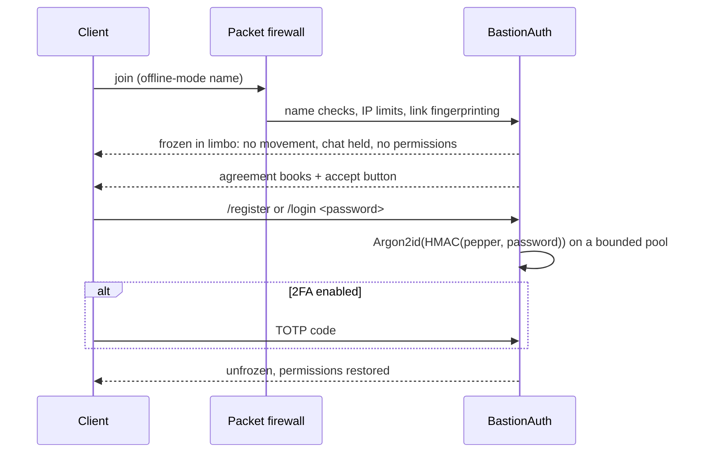

# BastionAuth

<p><b>English</b> · <a href="README.ru.md">Русский</a> · <a href="../README.md">← Bastion</a></p>

Hardened login and registration for **offline-mode** Fabric servers (Minecraft
1.21.11). In offline mode anyone can join under any name, so the server itself has to
prove who is who, and until it has, the connection must not be able to do anything.

## Highlights

**Cryptography**
- Passwords are hashed with **Argon2id** (BouncyCastle; 64 MiB, 3 iterations by
  default), each with its own salt.
- A **server pepper** is applied first: HMAC-SHA256 with `secret.key`. A stolen
  `auth.db` is useless without that file.
- Hashes are compared in constant time and stored in PHC format. They are re-hashed
  automatically when the parameters are raised.
- IP addresses are never stored in plain text: only an HMAC and a mask such as
  `1.2.*.*`.

**Frozen until login**
- **Packet firewall.** Before login, a whitelist on `ClientConnection.handlePacket`
  admits only the packets needed to type a password. Everything else is dropped
  before any vanilla handler sees it.
- **Permission freeze.** A frozen player has permission level 0, even with an
  operator's name. An impostor joining as an admin gets nothing, not even for one
  tick.
- The player cannot move (snap-back), is invisible and invulnerable, picks nothing
  up, sees no chat, and can run only `/login` and `/register`.
- **Location hidden until login.** The player waits in spectator mode in a limbo
  above their world's spawn and is sent no health, experience, effects, attributes
  or game mode. After the password they return to their real place and mode; a
  player who left riding sits back on their vehicle only then.

**Brute force and flood**
- Limits on failed logins per connection, per account (a lock that survives
  restarts) and per IP (sliding window).
- A limit on joins per IP per minute.
- **A growing per-IP account quota.** The first accounts register at once; each
  further one opens a week after the previous, then two weeks, three… A household
  or a shared NAT can still grow over time; a farm of alts cannot be made in an evening.
  Accounts nobody has entered for 30 days do not count, so one stranger's
  throwaway accounts behind a carrier NAT do not make newcomers wait.
- Argon2 runs in a bounded pool, so a crowd of bots cannot eat the tick.

**Account security**
- **TOTP two-factor authentication.** The QR code is drawn on an in-game map item;
  backup codes are included; `/login <password> <code>` works in one line.
- **Code word.** Protects dangerous actions: password change, disabling 2FA, large
  transfers in other mods.
- **Account history, panic lock and new-device warnings.**
- **Name protection.** A strict regex; no case-variant squatting (`steve` vs
  `Steve`); a second connection from another IP is refused while the owner is online.
- **Session resume** only from the same IP *and* the same client (keyed HMACs of
  the brand, language and main hand, which must match, and of the everyday settings,
  of which one may change — render distance, skin parts, particles, chat): a stranger
  behind the same carrier NAT cannot walk into someone else's account. Accounts
  with 2FA never resume; each operator chooses with `/auth strict`.
- **Agreement gate.** Server rules are handed out as books with an accept button. A
  separate timeout gives time to read them.

**Multi-account detection**
- Nine independent signals, scored together:
  - same device fingerprint;
  - same launcher UUID;
  - same client profile seen from another network;
  - same client mod channels;
  - same IP (HMAC);
  - similar names;
  - registration timing;
  - password reuse, compared by keyed fingerprints;
  - same typed server address.
- Grades: none, possible, likely, confirmed. Links are kept in a permanent ledger.
- Staff record their decisions on a pair with `/связи`: trusted, watch or
  multi-account.
- Other mods can ask `BastionAuth.accountsLinked(a, b)`.

## Login flow



## Commands

| Player | |
|---|---|
| `/register <pw> <pw>` (`/reg`), `/login <pw> [code]` (`/l`) | Register / log in |
| `/logout`, `/changepassword <old> <new> <new>` (`/changepw`) | Session and password |
| `/agreement [read\|accept\|books]` (`/соглашение`) | Server rules |
| `/2fa` · `включить` · `подтвердить <code>` · `выключить <code>` · `коды <code>` · `<code>` | Two-factor authentication; a bare code is the second login step |
| `/слово` (`/codeword`) · `установить <word>` · `снять <word>` · `<word>` | Code word |
| `/auth история`, `/auth lock` | Account history, panic lock |

| Staff (op 3+, also from the console) | |
|---|---|
| `/auth status <name>`, `/auth links <name>`, `/auth stats` | Inspect accounts and links |
| `/auth unlock <name>`, `/auth unregister <name>`, `/auth 2fa reset <name>` | Recovery |
| `/auth sessions clear` | Drop all IP sessions |
| `/auth strict [on\|off]` | Strict login for yourself as an operator (always ask for the password) |
| `/связи` (`/links`) — the queue of undecided links; `/связи <name>` | Account links and their verdicts |
| `/связи доверять\|наблюдать\|мульти\|сброс <a> <b> [note]`, `/связи доверять-все <name>` | Record a verdict on a pair, or trust all of an account's links |
| `/auth reload` | Reload the config |

## Technical reference

### Defaults (`config/bastionauth/config.json`)

| Key | Default | Meaning |
|---|---|---|
| `general.loginTimeoutSeconds` | 60 | time to log in before a kick |
| `general.agreementTimeoutSeconds` | 600 | separate time to read and accept the rules; the login clock starts after |
| `general.maxLoginTriesPerConnection` | 3 | wrong passwords per connection before a kick |
| `general.usernameRegex` | `^[A-Za-z0-9_]{3,16}$` | allowed names |
| `general.enforceExactNameCase` | true | `steve` cannot join while `Steve` is registered |
| `passwordRules` | 8–64 chars, letter + digit, no common passwords, ≠ name | |
| `hashing.memoryKib` / `iterations` / `parallelism` | 65536 / 3 / 1 | Argon2id cost; raising it rehashes on the next login |
| `hashing.maxConcurrentHashes` / `maxQueuedOperations` | 2 / 64 | hashing pool and queue; beyond the queue the answer is "busy" |
| `bruteForce.maxFailedPerAccount` / `accountLockMinutes` | 5 / 15 | account lock, kept across restarts |
| `bruteForce.ipMaxFailures` / `ipFailureWindowMinutes` / `ipBlockMinutes` | 10 / 5 / 15 | IP block |
| `bruteForce.blockJoinsFromBlockedIp` | false | a blocked IP is refused only at `/login`, not at join, so one carrier NAT is not locked out |
| `bruteForce.maxJoinsPerIpPerMinute` | 6 | join flood guard |
| `bruteForce.maxAccountsPerIp` / `extraAccountWaitDays` / `maxAccountsPerIpHard` | 5 / 7 / 0 | free accounts per IP, the waiting step, an absolute ceiling (0 = none) |
| `bruteForce.quotaIgnoresDormantDays` | 30 | accounts unused this long are not counted |
| `session.ttlMinutes` | 360 | session resume window; sessions survive restarts |
| `session.opStrictOptional` | true | each operator picks `/auth strict on\|off`; false = operators never resume a session |
| `twoFactor.codeTimeoutSeconds` / `maxTries` / `window` / `backupCodes` | 90 / 5 / ±1 step / 8 | TOTP |
| `codeword.unlockMinutes` | 5 | how long a spoken code word keeps guarded actions open |
| `linking.timingWindowHours` / `reportGrade` | 72 / `LIKELY` | "registered right after" window; lowest grade reported to staff and BastionAC |
| `protection.hideAccountState` / `hideLocation` / `spectatorBeforeLogin` | true | the login-screen masks |
| `protection.extraCommandWhitelist` | `[]` | extra commands allowed before login |

A config that is not valid JSON is saved as `config.json.broken-<time>` and
replaced with the secure defaults; the server keeps running with authentication.
`/auth reload` applies changes without a restart.

### Cryptography

- **Passwords:** `HMAC-SHA256(pepper, password)` → Argon2id, stored as a PHC string
  (`$argon2id$v=19$m=…,t=…,p=…$salt$hash`); verification uses the stored
  parameters and a constant-time compare.
- **`secret.key`** is the master secret; every purpose (pepper, IP HMAC, device
  HMAC, TOTP key) gets its own key derived from it by HMAC.
- **TOTP seeds** are encrypted with AES-256-GCM under the master key; backup codes
  are stored as keyed hashes, each good once; a code is never accepted for a step
  at or before the last accepted one (no replay).
- **Code word** is hashed like a password (Argon2id with the pepper).
- **IP addresses** are stored only as an HMAC and a mask (`1.2.*.*`).

### Before the password

| Layer | Where | What it does |
|---|---|---|
| Packet firewall | `ClientConnection.handlePacket` (netty thread) | allow-list: keep-alive, teleport confirm, chunk acks, tick end, chat/command packets, client options and brand, agreement buttons, UI state, the respawn button. Anything else, including any packet a future version adds, is dropped before its handler |
| Permission freeze | `ServerPlayerEntity.getPermissions` | returns no permissions; the command tree is re-sent after login |
| Command gate | `CommandManager` | only `/login`, `/register`, the agreement and the whitelist; a mistyped password command is not echoed to the log |
| Chat gate | outbound | system and player chat to a frozen player is held and delivered after login; titles and the action bar are dropped |
| Inventory and state mask | outbound | empty inventory view; no effects, armour, absorption, XP, game mode, flight or F3 coordinates; movement, jump and gravity zeroed |
| Limbo | join | the player waits above their world's spawn (0, 0 outside the overworld); the real position is written back for every save |
| Spectator gate | join | spectator once the agreement is on file; the real mode is written back for every save, unknown or spectator comes back as survival |

### Multi-account scoring

| Signal | Points |
|---|---|
| launcher UUID that is not name-derived | 70 |
| device hash (brand + client options + /24 subnet) | 60 |
| password reuse (keyed fingerprint) | 40 |
| same client profile from another network | 35 |
| same IP (HMAC) | 25 |
| same non-default mod channel list | 20 |
| registered within 72 h of the other account's last sighting | 20 |
| similar name (Levenshtein ≤ 2) | 15 |
| same typed server address | 5 |

Grades: 0–49 none, 50–79 possible, 80–99 likely, 100+ confirmed. Every pair at
50+ goes to the permanent `account_links` ledger. Punishment stays a human
decision.

### Storage

SQLite (`auth.db`) in WAL mode with `synchronous=FULL`, every query parameterised.
Tables: `users`, `sessions`, `audit_log` (kept 90 days), `device_fingerprints`,
`device_links`, `account_links`, `agreement_acceptance`, `totp`, `op_prefs`. If
authentication cannot start, the server does not start either.

### Behind a proxy

BastionAuth reads the IP from the connection itself. Behind BungeeCord or Velocity
without IP forwarding every player arrives as `127.0.0.1`: IP limits then count
the whole network as one address, IP links mean nothing, and session resume is
off for loopback addresses. Put an IP-forwarding mod on the backend, for example
[FabricProxy-Lite](https://modrinth.com/mod/fabricproxy-lite).

### For other mods

Static methods on `dev.bastionauth.BastionAuth`, meant to be called through
reflection: `isBlocked(player)`, `clientBrand(player)`,
`accountsLinked(a, b)`, `accountsLinkedForStateBenefits(a, b)`,
`linkLedger(uuid, limit)`, `linkVerdict(a, b)`, `setLinkVerdict(…)`,
`setVerdictForAllLinksOf(…)`, `unreviewedLinks()`, `uuidOfName(name)`,
`codewordProtects(uuid)`, `codewordSet(uuid)`, `twoFactorEnabled(uuid)`,
`authHistory(uuid, limit)`. BastionAuth itself reports links to BastionAC and
warns it before moving a player out of limbo.

## Build

```bash
./gradlew build   # JDK 21 → build/libs/bastionauth-<version>+build.<N>.jar
./gradlew test    # 100 unit tests
```

The jar bundles BouncyCastle 1.79, sqlite-jdbc 3.47.1.0 and ZXing 3.5.3. Fabric
API is required on the server. Back up `auth.db` and `secret.key` together:
without `secret.key` no password, TOTP seed or IP HMAC can be checked.

Full Russian documentation and version history: [`DETAILS.ru.md`](DETAILS.ru.md).
