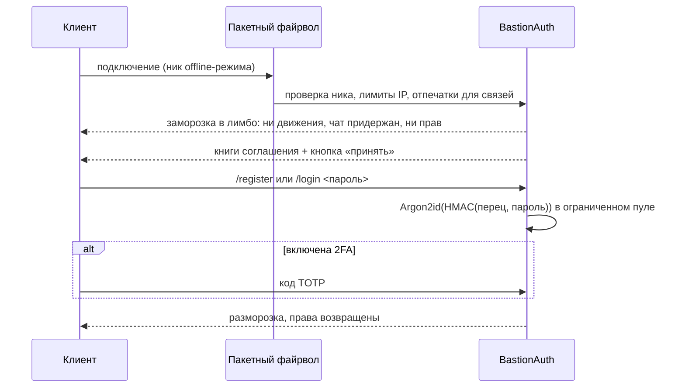

# BastionAuth

<p><a href="README.md">English</a> · <b>Русский</b> · <a href="../README.ru.md">← Bastion</a></p>

Защищённые вход и регистрация для **offline-серверов** на Fabric (Minecraft
1.21.11). В offline-режиме зайти можно под любым ником, поэтому сервер сам должен
установить, кто есть кто. А пока не установил, подключение не должно иметь
возможности сделать что-либо.

## Главное

**Криптография**
- Пароли хэшируются **Argon2id** (BouncyCastle; по умолчанию 64 МиБ и 3
  итерации), у каждого своя соль.
- Сначала применяется **серверный «перец»**: HMAC-SHA256 с ключом из
  `secret.key`. Украденный `auth.db` без этого файла бесполезен.
- Хэши сравниваются за постоянное время и хранятся в формате PHC. При повышении
  параметров они автоматически пересчитываются.
- IP-адреса не хранятся в открытом виде: только HMAC и маска вида `1.2.*.*`.

**Заморозка до входа**
- **Пакетный файрвол.** До входа белый список на `ClientConnection.handlePacket`
  пропускает только пакеты, нужные для ввода пароля. Всё остальное
  отбрасывается раньше, чем дойдёт до ванильного обработчика.
- **Заморозка прав.** У замороженного игрока уровень прав 0, даже если ник
  совпадает с ником оператора. Самозванец под ником админа не получает ничего —
  ни на один тик.
- Игрок не может двигаться (его возвращает на место), невидим и неуязвим, не
  подбирает предметы, не видит чат, и ему доступны только `/login` и `/register`.
- **Место скрыто до пароля.** Игрок ждёт в режиме наблюдателя в «лимбо» над
  спавном своего мира, клиенту не отдаются здоровье, опыт, эффекты, атрибуты и
  режим игры. После пароля он возвращается на своё место и в свой режим; вышедший
  верхом садится обратно на транспорт только тогда.

**Перебор паролей и флуд**
- Лимиты неверных паролей на подключение, на аккаунт (блокировка переживает
  рестарт) и на IP (скользящее окно).
- Лимит подключений с одного IP в минуту.
- **Лимит аккаунтов на IP с растущим ожиданием.** Первые аккаунты регистрируются
  сразу; каждый следующий — через неделю после предыдущего, потом через две, три…
  Семья или общий NAT со временем могут добавить аккаунт, ферму твинков за вечер не
  создать. Аккаунты, в которые не заходили 30 дней, не считаются: одноразовые
  аккаунты чужого человека за NAT оператора не заставляют новичков ждать.
- Argon2 выполняется в ограниченном пуле, поэтому толпа ботов не съест TPS.

**Безопасность аккаунта**
- **Двухфакторная защита (TOTP).** QR-код рисуется на карте прямо в игре; есть
  резервные коды; `/login <пароль> <код>` работает одной строкой.
- **Кодовое слово.** Защищает опасные действия: смену пароля, отключение 2FA,
  крупные переводы в других модах.
- **История входов, «паника» и предупреждения о новом устройстве.**
- **Защита ников.** Строгий шаблон ника; занять чужой ник другим регистром
  (`steve` вместо `Steve`) нельзя; второе подключение с другого IP, пока хозяин
  онлайн, отклоняется.
- **Сессии** без повторного пароля — только с того же IP *и* того же клиента.
  Бренд, язык и ведущая рука должны совпасть, из повседневных настроек
  (дальность прорисовки, части скина, частицы, чат) может отличаться одна; всё
  хранится отдельными HMAC. Сосед за тем же NAT мобильного оператора в чужой
  аккаунт не войдёт. Аккаунты с 2FA сессию не возобновляют; операторы решают
  сами через `/auth strict`.
- **Соглашение.** Правила сервера выдаются книгами с кнопкой «принять». На
  чтение даётся отдельное время.

**Поиск твинков**
- Девять независимых сигналов, баллы складываются:
  - одинаковый отпечаток устройства;
  - одинаковый UUID лаунчера;
  - тот же профиль клиента из другой сети;
  - один набор модов клиента;
  - тот же IP (HMAC);
  - похожие ники;
  - время регистрации;
  - повтор пароля (сравниваются ключевые отпечатки);
  - тот же набранный адрес сервера.
- Оценки: нет, возможная, вероятная, подтверждённая. Связи хранятся в
  постоянном реестре.
- Решение по паре персонал выносит командой `/связи`: доверенная, под
  наблюдением или мультиаккаунт.
- Другие моды могут спросить `BastionAuth.accountsLinked(a, b)`.

## Как проходит вход



## Команды

| Игрок | |
|---|---|
| `/register <пароль> <пароль>` (`/reg`), `/login <пароль> [код]` (`/l`) | Регистрация и вход |
| `/logout`, `/changepassword <старый> <новый> <новый>` (`/changepw`) | Сессия и пароль |
| `/agreement [read\|accept\|books]` (`/соглашение`) | Правила сервера |
| `/2fa` · `включить` · `подтвердить <код>` · `выключить <код>` · `коды <код>` · `<код>` | Двухфакторная защита; голый код — второй шаг входа |
| `/слово` (`/codeword`) · `установить <слово>` · `снять <слово>` · `<слово>` | Кодовое слово |
| `/auth история`, `/auth lock` | История аккаунта, «паника» |

| Персонал (OP 3+, работает и из консоли) | |
|---|---|
| `/auth status <ник>`, `/auth links <ник>`, `/auth stats` | Аккаунты и связи |
| `/auth unlock <ник>`, `/auth unregister <ник>`, `/auth 2fa reset <ник>` | Восстановление |
| `/auth sessions clear` | Сбросить все IP-сессии |
| `/auth strict [on\|off]` (`/auth строгий [вкл\|выкл]`) | Строгий вход для себя как оператора (всегда спрашивать пароль) |
| `/связи` (`/links`) — очередь связей без решения; `/связи <ник>` | Связи аккаунта и их статусы |
| `/связи доверять\|наблюдать\|мульти\|сброс <a> <b> [заметка]`, `/связи доверять-все <ник>` | Решение по паре или доверие ко всем связям аккаунта |
| `/auth reload` | Перечитать конфиг |

## Технический справочник

### Значения по умолчанию (`config/bastionauth/config.json`)

| Ключ | По умолчанию | Смысл |
|---|---|---|
| `general.loginTimeoutSeconds` | 60 | время на вход до кика |
| `general.agreementTimeoutSeconds` | 600 | отдельное время прочитать и принять правила; таймер входа идёт после |
| `general.maxLoginTriesPerConnection` | 3 | неверных паролей за подключение до кика |
| `general.usernameRegex` | `^[A-Za-z0-9_]{3,16}$` | допустимые ники |
| `general.enforceExactNameCase` | true | `steve` не войдёт, пока зарегистрирован `Steve` |
| `passwordRules` | 8–64 символа, буква и цифра, не из популярных, ≠ ник | |
| `hashing.memoryKib` / `iterations` / `parallelism` | 65536 / 3 / 1 | стоимость Argon2id; при повышении хэш пересчитывается при следующем входе |
| `hashing.maxConcurrentHashes` / `maxQueuedOperations` | 2 / 64 | пул хэширования и очередь; сверх очереди ответ «занято» |
| `bruteForce.maxFailedPerAccount` / `accountLockMinutes` | 5 / 15 | блокировка аккаунта, переживает рестарт |
| `bruteForce.ipMaxFailures` / `ipFailureWindowMinutes` / `ipBlockMinutes` | 10 / 5 / 15 | блокировка IP |
| `bruteForce.blockJoinsFromBlockedIp` | false | заблокированный IP получает отказ только на `/login`, а не при входе, чтобы не закрыть сервер целому NAT оператора |
| `bruteForce.maxJoinsPerIpPerMinute` | 6 | защита от флуда подключениями |
| `bruteForce.maxAccountsPerIp` / `extraAccountWaitDays` / `maxAccountsPerIpHard` | 5 / 7 / 0 | аккаунтов с IP сразу, шаг ожидания, абсолютный потолок (0 — нет) |
| `bruteForce.quotaIgnoresDormantDays` | 30 | аккаунты без входа дольше не считаются |
| `session.ttlMinutes` | 360 | окно возобновления сессии; сессии переживают рестарт |
| `session.opStrictOptional` | true | каждый оператор выбирает `/auth strict on\|off`; false — операторы никогда не возобновляют сессию |
| `twoFactor.codeTimeoutSeconds` / `maxTries` / `window` / `backupCodes` | 90 / 5 / ±1 шаг / 8 | TOTP |
| `codeword.unlockMinutes` | 5 | сколько минут произнесённое кодовое слово держит защищённые действия открытыми |
| `linking.timingWindowHours` / `reportGrade` | 72 / `LIKELY` | окно «зарегистрирован сразу после»; минимальная степень, о которой узнают персонал и BastionAC |
| `protection.hideAccountState` / `hideLocation` / `spectatorBeforeLogin` | true | маски экрана входа |
| `protection.extraCommandWhitelist` | `[]` | дополнительные команды до входа |

Конфиг с битым JSON сохраняется как `config.json.broken-<время>` и заменяется
безопасными значениями; сервер продолжает работать с авторизацией.
`/auth reload` применяет изменения без рестарта.

### Криптография

- **Пароли:** `HMAC-SHA256(перец, пароль)` → Argon2id, хранится строкой PHC
  (`$argon2id$v=19$m=…,t=…,p=…$соль$хэш`); проверка идёт с параметрами из самого
  хэша и сравнением за постоянное время.
- **`secret.key`** — мастер-секрет; для каждой задачи (перец, HMAC IP и устройства,
  ключ TOTP) из него через HMAC выводится свой ключ.
- **Сиды TOTP** зашифрованы AES-256-GCM мастер-ключом; резервные коды хранятся
  ключевыми хэшами, каждый одноразовый; код не принимается для шага не позже
  последнего принятого (повтор не пройдёт).
- **Кодовое слово** хэшируется как пароль (Argon2id с перцем).
- **IP-адреса** хранятся только как HMAC и маска (`1.2.*.*`).

### До пароля

| Слой | Где | Что делает |
|---|---|---|
| Пакетный файрвол | `ClientConnection.handlePacket` (поток netty) | белый список: keep-alive, подтверждение телепорта, подтверждения чанков, конец тика, пакеты чата и команд, настройки и бренд клиента, кнопки соглашения, состояние интерфейса, кнопка возрождения. Всё остальное, в том числе пакеты будущих версий, отбрасывается до обработчика |
| Заморозка прав | `ServerPlayerEntity.getPermissions` | прав нет; после входа дерево команд пересылается заново |
| Фильтр команд | `CommandManager` | только `/login`, `/register`, соглашение и белый список; команда с опечаткой в пароле не попадает в лог |
| Фильтр чата | исходящие пакеты | системный чат и сообщения игроков придерживаются и доставляются после входа; титулы и строка действия отбрасываются |
| Маска инвентаря и состояния | исходящие пакеты | пустой инвентарь; ни эффектов, ни брони, ни поглощения, ни опыта, ни режима игры, ни полёта, ни координат F3; скорость, прыжок и гравитация обнулены |
| Лимбо | вход | игрок ждёт над спавном своего мира (0, 0 вне верхнего мира); при каждом сохранении записывается настоящая позиция |
| Режим наблюдателя | вход | наблюдатель после принятия соглашения; при каждом сохранении записывается настоящий режим, неизвестный или наблюдатель возвращается как выживание |

### Баллы связей аккаунтов

| Сигнал | Баллы |
|---|---|
| UUID лаунчера, не выведенный из ника | 70 |
| хэш устройства (бренд + настройки клиента + подсеть /24) | 60 |
| один пароль (ключевой отпечаток) | 40 |
| тот же профиль клиента из другой сети | 35 |
| тот же IP (HMAC) | 25 |
| тот же нестандартный список каналов модов | 20 |
| регистрация в пределах 72 ч после последнего появления другого аккаунта | 20 |
| похожий ник (Левенштейн ≤ 2) | 15 |
| тот же набранный адрес сервера | 5 |

Степени: 0–49 — нет, 50–79 — возможно, 80–99 — вероятно, 100+ — подтверждено.
Каждая пара от 50 баллов попадает в вечный реестр `account_links`. Решение о
наказании остаётся за человеком.

### Хранение

SQLite (`auth.db`) в режиме WAL с `synchronous=FULL`, все запросы
параметризованы. Таблицы: `users`, `sessions`, `audit_log` (хранится 90 дней),
`device_fingerprints`, `device_links`, `account_links`, `agreement_acceptance`,
`totp`, `op_prefs`. Если авторизация не смогла запуститься, сервер тоже не
запускается.

### За прокси

BastionAuth берёт IP из самого соединения. За BungeeCord или Velocity без проброса
IP все игроки приходят с `127.0.0.1`: лимиты по IP считают всю сеть одним
адресом, связи по IP теряют смысл, а возобновление сессии для loopback-адресов
отключено. Поставьте на backend мод проброса IP, например
[FabricProxy-Lite](https://modrinth.com/mod/fabricproxy-lite).

### Для других модов

Статические методы `dev.bastionauth.BastionAuth`, рассчитанные на вызов через
рефлексию: `isBlocked(player)`, `clientBrand(player)`,
`accountsLinked(a, b)`, `accountsLinkedForStateBenefits(a, b)`,
`linkLedger(uuid, limit)`, `linkVerdict(a, b)`, `setLinkVerdict(…)`,
`setVerdictForAllLinksOf(…)`, `unreviewedLinks()`, `uuidOfName(name)`,
`codewordProtects(uuid)`, `codewordSet(uuid)`, `twoFactorEnabled(uuid)`,
`authHistory(uuid, limit)`. Сам BastionAuth сообщает о связях в BastionAC и
предупреждает его, прежде чем вывести игрока из лимбо.

## Сборка

```bash
./gradlew build   # JDK 21 → build/libs/bastionauth-<версия>.jar
./gradlew test    # 90 юнит-тестов
```

Внутри jar — BouncyCastle 1.79, sqlite-jdbc 3.47.1.0 и ZXing 3.5.3. На сервере
нужен Fabric API. Бэкапьте `auth.db` и `secret.key` вместе: без `secret.key` не
проверить ни пароль, ни сид TOTP, ни HMAC IP.

Полная документация и история версий: [`DETAILS.ru.md`](DETAILS.ru.md).
