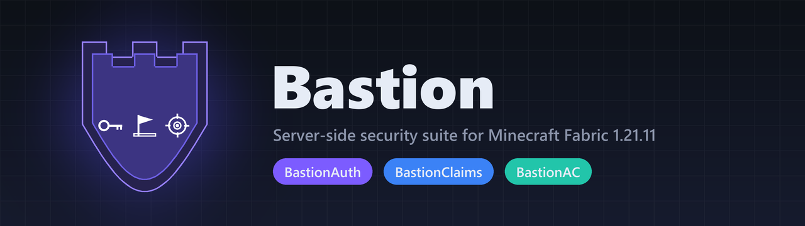
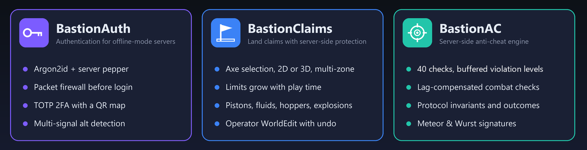
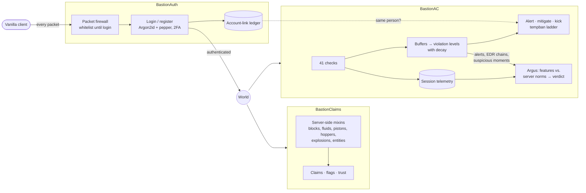

<p align="center">
  
</p>

<p align="center">
  
  
  
  
  
  
</p>

<p align="center"><b>English</b> · <a href="README.ru.md">Русский</a></p>

**Bastion** is a family of three server-side mods that protect an offline-mode
("cracked") Minecraft server: accounts, land and fair play. Everything runs on the
server — players join with an unmodified client and install nothing.

<p align="center"></p>

## Status

- **Built for a Minecraft 1.21.11 server on Fabric only.** No other server version
  or mod loader has been built or tested.
- **Clients 1.21.1 – 26.3 can play** when ViaVersion and ViaBackwards run on the
  server: Via translates their packets, and the mods work with them unchanged.
  BastionAC knows each player's real client version and adapts the checks that
  depend on it (clients older than 1.21.2 send no tick ends and no keys of their own).
- **Running in production** on the MaxCora server: `MaxCore.mcje.in:36651`
  (Java Edition 1.21.1 – 26.3, any launcher). You are welcome to join and try to break it.
- **The published code can lag behind the live build.** For security reasons,
  updates reach this repository on a schedule and with a delay, so the server may run
  a newer and stronger build than the one published here.
- In-game texts are in Russian (the server's language). Code comments and this
  documentation are in English.

## Modules

| Module | Version | In one line |
|---|---|---|
| [**BastionAuth**](BastionAuth) | 1.12.2 | Login and registration for offline-mode servers: Argon2id with a server pepper, a packet firewall before login, TOTP 2FA, multi-account detection, a growing per-IP account quota, sessions bound to IP and client profile. Before the password the player waits in spectator mode, away from their real location. |
| [**BastionClaims**](BastionClaims) | 1.19.1 | Land claims protected by server-side mixins, not only client callbacks: pistons, fluids, hoppers, dispensers, explosions, fire, projectiles, falling blocks, griefing mobs, fishing rods, sculk. Member roles inside a claim. Also includes an operator WorldEdit with undo. |
| [**BastionAC**](BastionAC) | 3.4.0 | Anti-cheat engine: 41 checks, buffered violation levels with decay, lag-compensated combat, protocol invariants, Meteor and Wurst signatures. Since 3.0: full session telemetry and **Argus**, an analytical investigation that reads a player's whole session and returns a verdict within minutes. Since 3.3 its model is trained in Argus Lab on synthetic honest and cheating sessions; 3.3.1 adds an info shield against ESP-style information cheats and InteractWalls; 3.4 catches ClickTP on foot and lets Argus see teleports. Exploits (book/NBT bombs, creative smuggling, packet floods) are blocked at the protocol. |

Each mod works on its own. When they run together, they talk through soft
reflection bridges, and no mod has a hard dependency on another:

| From → to | What crosses |
|---|---|
| BastionAuth → BastionAC | graded account links (`noteLinkedAccount`); a warning before a player leaves limbo (`expectServerMove`), so the move is not a teleport |
| BastionAC → BastionAuth | whether a player is still held before login (checks stand down); the client brand captured at configuration; the link ledger, read and given verdicts from the `/bac` network tab |
| BastionClaims → BastionAuth | the code word, required before a claim is transferred or deleted; a broken bridge fails closed |
| BastionClaims ↔ MaxCore | Claims reads MaxCore's build mode (builders get WorldEdit under its creative block rules); MaxCore reads the sidebar line (`ClaimApi.statusLine`) and arrests claims for unpaid land tax (`taxRoll`, `setArrested`) |

A missing mod simply leaves its bridge off.

## How they fit together



## Principles

- **Server authority.** Protection lives in server-side hooks and mixins, so a
  client that skips the vanilla code path cannot skip the protection.
- **Fail closed.** An unreadable claims file refuses to start instead of silently
  unprotecting the world. Credentials are never written in plain text.
- **Evidence over hunches.** The anti-cheat buffers every suspicion and punishes
  only what repeats. Checks prefer outcomes and protocol facts over client-specific
  signatures.
- **Explainable decisions.** `/claim why`, `/claim trace`, `/auth links` and the
  `/bac` panel say *why* something was allowed, refused or flagged.
- **Light by design.** Live checks are cheap per packet; the heavy analysis (a
  physics replay of the whole session, combat statistics, the X-ray world test)
  runs once per case on its own thread and pauses when the server is busy. On a
  2 vCPU / 4 GB server the suite stays nearly idle.
- **Proactive, not only reactive.** What a cheat could read is not sent (other
  players' health and gear details, far sound origins, the Nether past its fog,
  the account before login); what a vanilla client could never send (book and
  NBT bombs, creative smuggling, floods, clicks through walls) is dropped on the
  spot.

## Building

Each module is a standalone Gradle project. You need JDK 21; the Gradle wrapper
downloads everything else.

```bash
cd BastionAC        # or BastionAuth / BastionClaims
./gradlew build     # → build/libs/<mod>-<version>.jar
```

To install, put the jar into the server's `mods/` folder next to
[Fabric API](https://modrinth.com/mod/fabric-api). Each mod writes its config to
`config/<mod>/` on first start.

## Tests

The repository has 350 unit tests: 90 in BastionAuth, 58 in BastionClaims and 202
in BastionAC. Run them with `./gradlew test` in a module folder. Gradle's
forked test worker cannot run from a path with non-ASCII characters, and on such
a path the `test` task is skipped; either build from an ASCII path or run
`./gradlew dumpTestClasspath` and start the JUnit ConsoleLauncher with
`build/test-classpath.txt`. The anti-cheat checks were also tested live with a
raw-protocol client that sends the exact packets of the cheat modules they
target, and Argus with the Argus Lab bench (`./gradlew argusLab` in
`BastionAC`).

## Documentation

- Every module has an English overview (`README.md`) and a Russian one
  (`README.ru.md`).
- `DETAILS.ru.md` in each module holds the full Russian documentation and the
  version history.
- [`BastionAC/ARGUS-LAB.ru.md`](BastionAC/ARGUS-LAB.ru.md) is the Argus Lab report:
  how the Argus model is trained and how well it detects each cheat.

## License

[PolyForm Noncommercial 1.0.0](LICENSE). You may use, fork, change and
distribute the mods for any noncommercial purpose, as long as every copy carries
the license and the `Required Notice` line. Commercial use is **not** allowed:
selling the mods or forks of them, or running them on a server that earns money
(donations for perks, paid ranks, paid access). For commercial terms, contact the
author.

## Author

[@dhehdjebejen-beep](https://github.com/dhehdjebejen-beep)
