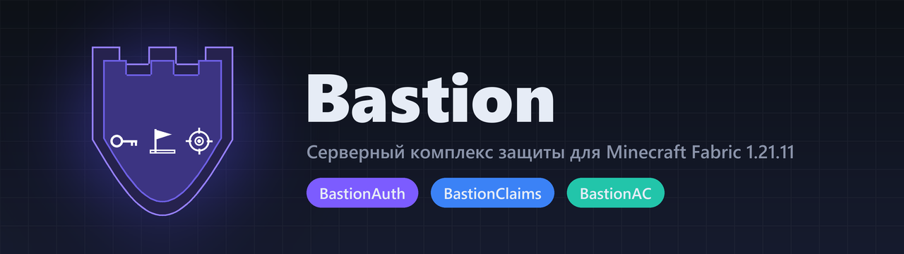
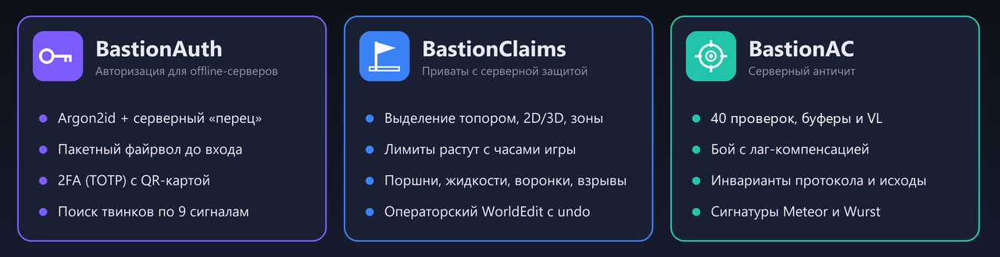
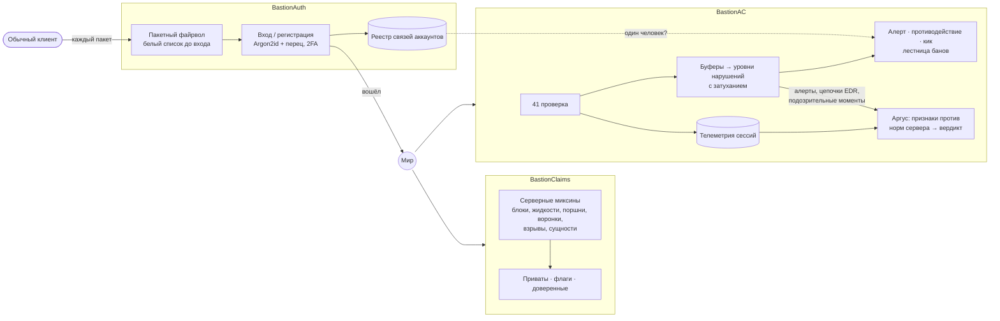

<p align="center">
  
</p>

<p align="center">
  
  
  
  
  
  
</p>

<p align="center"><a href="README.md">English</a> · <b>Русский</b></p>

**Bastion** — семейство из трёх серверных модов для защиты offline-сервера
Minecraft («пиратки»). Они защищают аккаунты, территорию и честность игры. Всё
работает на стороне сервера: игроки заходят с обычным клиентом и ничего не ставят.

<p align="center"></p>

## Идея проекта

- **Zero Trust к каждому игроку.** До входа игрок не получает ничего: ни мира
  (вместо чанков — пустые), ни чата, ни инвентаря, ни команд, ни чужих пакетов
  своих модов. Доверие не выдаётся по нику, IP или «лицензии» — его надо
  доказать паролем, 2FA или узнаваемым устройством.
- **Без премиум-входа — сознательно.** Автовход по лицензии Mojang не сделан:
  сессию Mojang, на взгляд автора, можно украсть, и тогда она открывает аккаунт
  без всяких вопросов. Вместо неё — свои механизмы: сессия, привязанная к IP,
  профилю клиента и установке лаунчера, 2FA и кодовое слово. Постоянный игрок
  заходит без пароля, а украденный ник — нет.
- **Античит, который точен, а не тяжёл.** Проверки опираются на физику и
  протокол ванили, а спорные случаи разбирает Аргус по всей сессии — вместо
  того чтобы симулировать каждого игрока на каждом тике.
- **Спортивный интерес.** Весь проект написан из любопытства: разобраться, как
  устроены читы и защита от них, и посмотреть, что из этого получится.

## Статус

- **Сделано только под сервер Minecraft 1.21.11 на Fabric.** Под другие версии
  сервера и другие загрузчики моды не собирались и не проверялись.
- **Играть можно с клиентов 1.21.1 – 26.3**, если на сервере стоят ViaVersion и
  ViaBackwards: Via переводит их пакеты, а моды работают с ними без изменений.
  BastionAC знает настоящую версию клиента каждого игрока и подстраивает проверки,
  которые от неё зависят: клиенты старше 1.21.2 не шлют своих концов тиков и клавиш.
- **Работает на живом сервере MaxCora:** `MaxCore.mcje.in:36651` (Java Edition
  1.21.1 – 26.3, подойдёт любой лаунчер). Заходите и попробуйте что-нибудь сломать.
- **Опубликованный код может отставать от серверной сборки.** Из соображений
  безопасности обновления попадают сюда по графику и с задержкой. На сервере может
  стоять более новая и мощная сборка, чем опубликованная здесь.
- Тексты в игре на русском (язык сервера). Комментарии в коде и документация на
  английском, у каждого мода есть README и на русском.

## Модули

| Мод | Версия | Коротко |
|---|---|---|
| [**BastionAuth**](BastionAuth) | 1.13.0 | Вход и регистрация на offline-сервере: Argon2id с серверным «перцем», пакетный файрвол до входа, 2FA (TOTP), поиск твинков, лимит аккаунтов на IP с растущим ожиданием, сессии по IP, профилю клиента и установке лаунчера. До пароля игрок ждёт в режиме наблюдателя, вдали от своего настоящего места, и получает пустые чанки вместо мира. |
| [**BastionClaims**](BastionClaims) | 1.20.0 | Приваты, защищённые серверными миксинами, а не только клиентскими событиями: поршни, жидкости, воронки, раздатчики и крафтеры, взрывы, огонь, снаряды, падающие блоки, мобы-грифферы, тихони, медные големы, порталы, удочки, скалк. Роли пользователей внутри привата. Есть операторский WorldEdit с отменой. |
| [**BastionAC**](BastionAC) | 3.5.0-beta | Античит: 41 проверка, буферы нарушений с затуханием, бой с лаг-компенсацией, инварианты протокола, сигнатуры Meteor и Wurst. Телеметрия всей сессии и **Аргус**: аналитическое расследование, которое читает сессию игрока и выносит вердикт; его модель обучена в Argus Lab на синтетических и реальных сессиях и видит худшую стычку сессии (читы, включённые на одну драку). 3.5 beta добавляет **проактивный режим**: проверки только сигналят, а санкции включает вердикт Аргуса через секунды. Эксплойты (книги- и NBT-бомбы, креативная контрабанда, флуд пакетами) блокируются на уровне протокола. |

Каждый мод работает сам по себе. Вместе они общаются через мягкие мосты на
рефлексии, жёстких зависимостей между модами нет:

| Откуда → куда | Что передаётся |
|---|---|
| BastionAuth → BastionAC | найденные связи аккаунтов со степенью (`noteLinkedAccount`); предупреждение перед выводом игрока из лимбо (`expectServerMove`), чтобы перемещение не сочли телепортом |
| BastionAC → BastionAuth | держит ли BastionAuth игрока до входа (проверки его не трогают); бренд клиента из фазы конфигурации; реестр связей — его читает и пополняет решениями вкладка «Сеть» в `/bac` |
| BastionClaims → BastionAuth | кодовое слово перед передачей и удалением привата; сломанный мост закрывается |
| BastionClaims ↔ MaxCore | Claims читает режим стройки MaxCore (строители получают WorldEdit по его правилам творческих блоков); MaxCore читает строку сайдбара (`ClaimApi.statusLine`) и арестовывает приваты за неуплату налога (`taxRoll`, `setArrested`) |

Если мода нет, его мост просто выключен.

## Как это устроено



## Принципы

- **Решает сервер.** Защита стоит в серверных хуках и миксинах. Клиент, который
  обходит ванильный путь, не обходит защиту.
- **Отказ по умолчанию.** Нечитаемый файл приватов не даёт моду стартовать, а не
  открывает весь мир. Пароли и IP нигде не хранятся в открытом виде.
- **Доказательства, а не догадки.** Античит копит каждое подозрение и наказывает
  только за то, что повторяется. Проверки опираются на исход и на факты протокола,
  а не на сигнатуру конкретного клиента.
- **Решения объяснимы.** `/claim why`, `/claim trace`, `/auth links` и панель
  `/bac` показывают, *почему* действие разрешено, запрещено или помечено.
- **Лёгкость по замыслу.** Живые проверки дешёвые на каждый пакет, а тяжёлый
  анализ (повтор физики всей сессии, статистика боя, тест X-ray по миру) идёт
  один раз на дело в отдельном потоке и ставится на паузу, когда сервер
  нагружен.
- **Не только реакция, но и профилактика.** То, что мог бы прочитать чит, не
  отправляется (чужое здоровье и детали экипировки, координаты дальних звуков,
  Незер за туманом, аккаунт до входа), а то, чего обычный клиент прислать не
  может (книги- и NBT-бомбы, креативная контрабанда, флуд, клики сквозь стены),
  отбрасывается сразу.

## Сборка

Каждый мод — отдельный Gradle-проект. Нужен JDK 21, остальное скачает Gradle
wrapper.

```bash
cd BastionAC        # или BastionAuth / BastionClaims
./gradlew build     # → build/libs/<мод>-<версия>+build.<N>.jar
```

Версия мода меняется только с новыми возможностями; каждая сборка между ними
получает следующий номер (`3.5.0-beta+build.4`). Счётчик лежит в
`<мод>/build.number`, общий скрипт — [`buildnumber.gradle`](buildnumber.gradle).

Для установки положите jar в папку `mods/` сервера рядом с
[Fabric API](https://modrinth.com/mod/fabric-api). При первом запуске каждый мод
создаст конфиг в `config/<мод>/`.

## Тесты

В репозитории 383 юнит-теста: 100 в BastionAuth, 62 в BastionClaims и 221 в
BastionAC. Запуск — `./gradlew test` в папке мода. Модель
Аргуса обучается и оценивается на стенде Argus Lab (`./gradlew argusLab` в
`BastionAC`).

## Документация

- У каждого мода есть обзор на английском (`README.md`) и на русском
  (`README.ru.md`).
- `DETAILS.ru.md` в каждом моде — полная документация на русском и история версий.
- [`BastionAC/ARGUS-LAB.ru.md`](BastionAC/ARGUS-LAB.ru.md) — отчёт Argus Lab: как
  обучается модель Аргуса и насколько хорошо она ловит каждый чит.

## Лицензия

[PolyForm Noncommercial 1.0.0](LICENSE). Моды можно использовать, форкать,
изменять и распространять в любых некоммерческих целях, если с каждой копией
идут текст лицензии и строка `Required Notice`. Коммерческое использование
**запрещено**: продажа модов и их форков, а также запуск на сервере, который
приносит деньги (донат за привилегии, платные ранги, платный вход). Для
коммерческих условий напишите автору.

## Автор

[@dhehdjebejen-beep](https://github.com/dhehdjebejen-beep)
